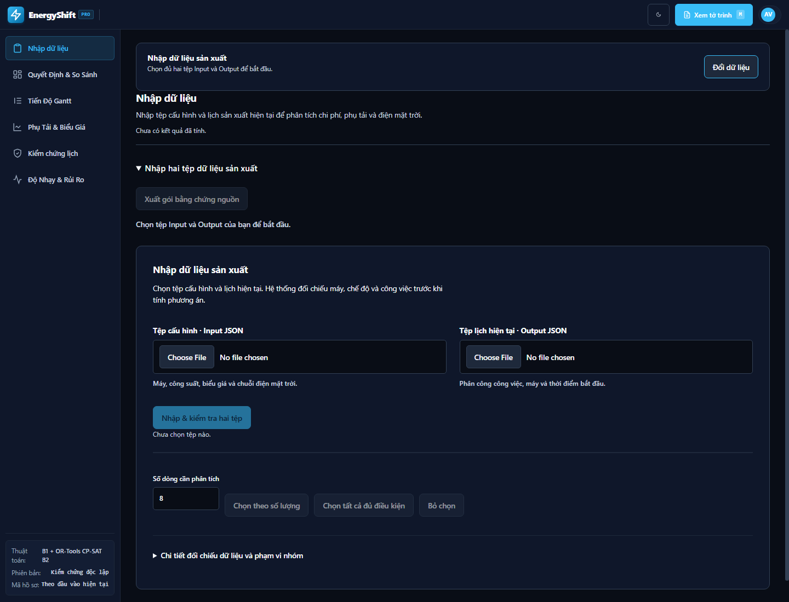
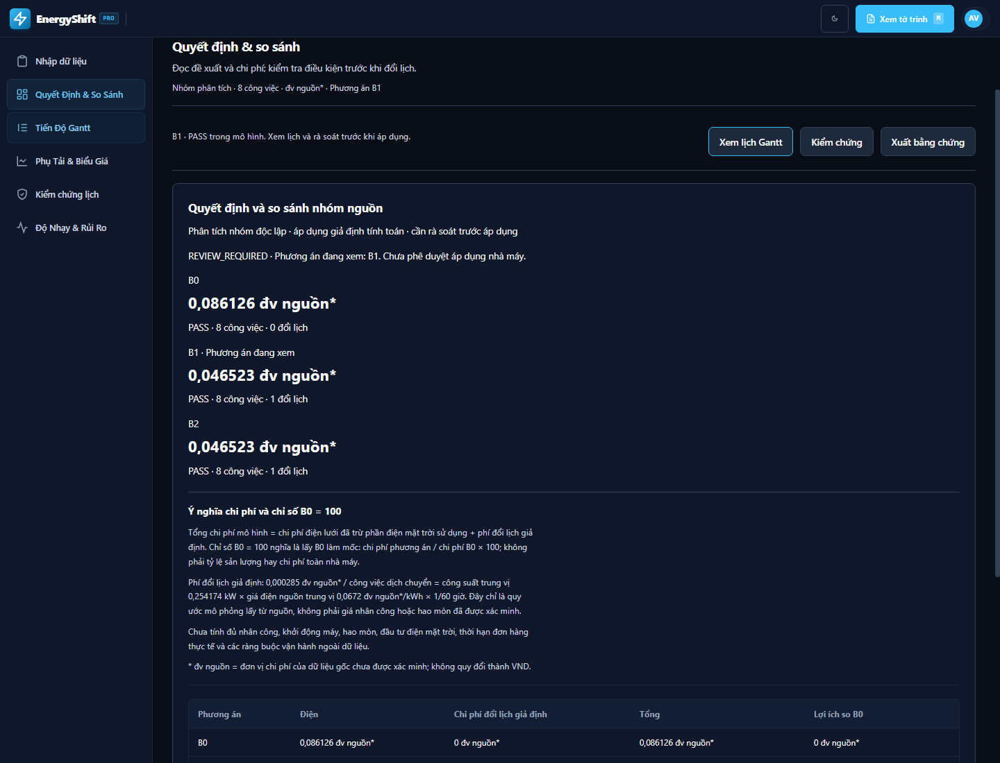
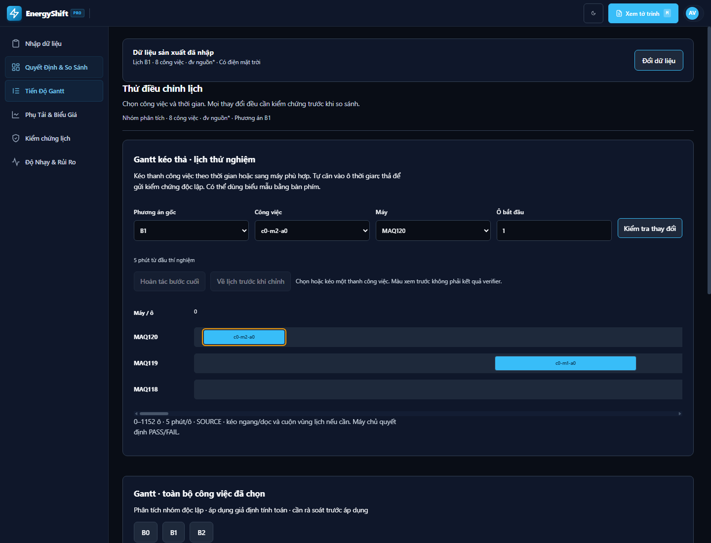
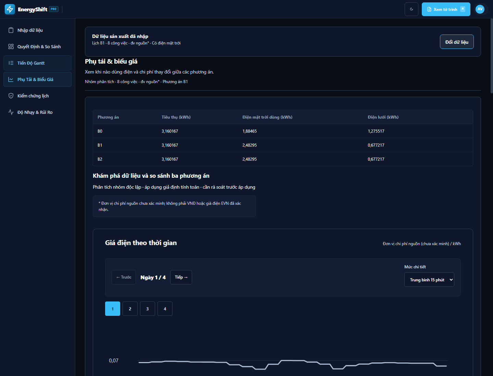
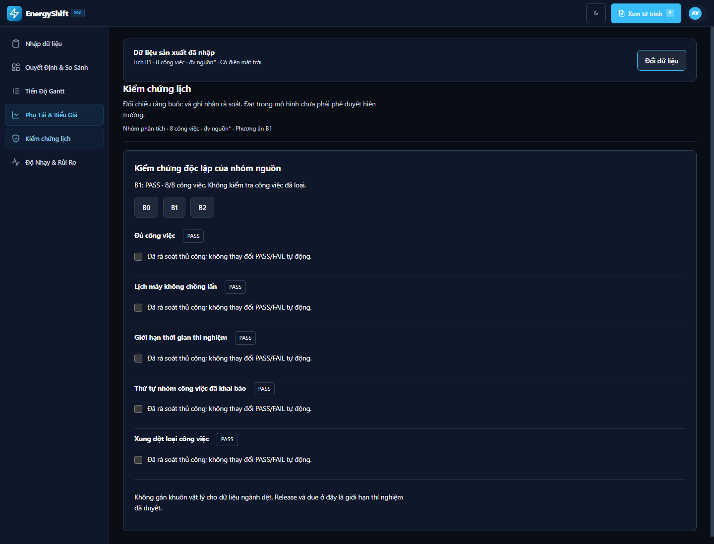
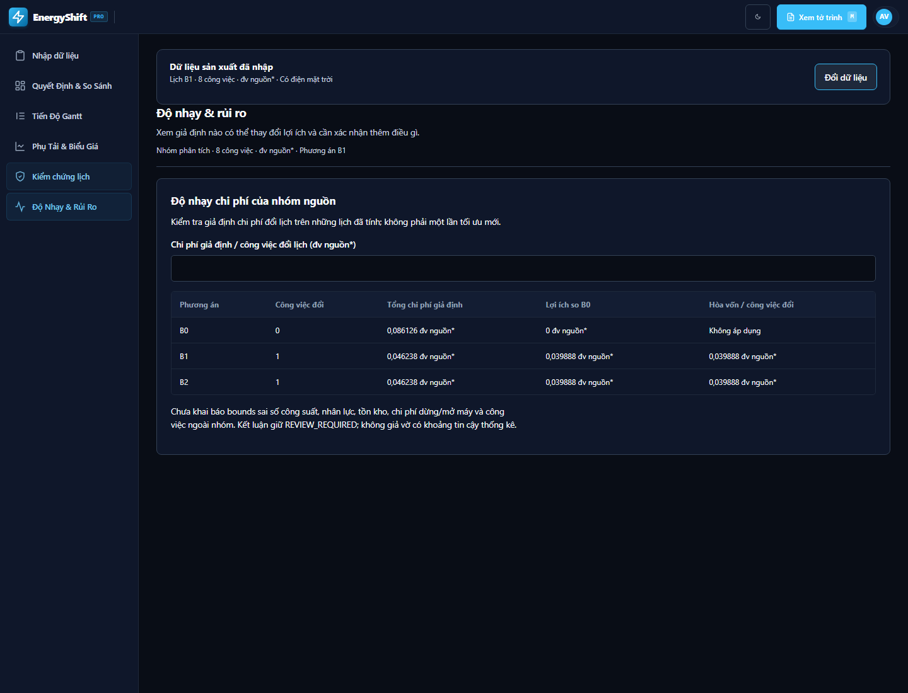

# Hướng dẫn trình bày EnergyShift — nhập hai tệp và phân tích điện mặt trời

Giao diện hiện tại bắt đầu bằng thao tác nhập tệp. Không chọn kịch bản dựng sẵn, không bấm nút nạp dữ liệu mẫu và không cần điền bảng tham số.

## 1. Chuẩn bị trước buổi trình bày

Mở **http://127.0.0.1:8000/** và nhấn **Ctrl+F5** để tải giao diện mới. Backend phải đang chạy. Nếu cần khởi động:

```powershell
cd "D:\UI Demo - GitHub main"
.\.venv\Scripts\python.exe ops/run-demo.py
```

Chuẩn bị đúng hai tệp trong thư mục gốc dự án:

| Vị trí chọn tệp trên giao diện | Tệp cần chọn | Nội dung |
| --- | --- | --- |
| **Tệp cấu hình · Input JSON** | [Input_JSON_Schedule_Optimization.json](Input_JSON_Schedule_Optimization.json) | Máy, chế độ thực hiện, chuỗi công suất, biểu giá, chuỗi điện mặt trời và ràng buộc |
| **Tệp lịch hiện tại · Output JSON** | [Output_JSON_Schedule_Optimization.json](Output_JSON_Schedule_Optimization.json) | Lịch được cung cấp: máy, công việc, chế độ và thời điểm bắt đầu |

Tệp có tên `Output` là lịch nguồn dùng để dựng B0. Đây không phải tệp kết quả mới do ứng dụng vừa tạo. Không nhập `S-I-JSP.zip` hoặc JSON của Factory Lab trong luồng này.

Màn hình bắt đầu:



## 2. Chọn tệp Input

Trong tab **Nhập dữ liệu**, bấm **Choose File** ở ô **Tệp cấu hình · Input JSON**. Trình duyệt tiếng Việt có thể hiển thị **Chọn tệp**.

Chọn:

```text
D:\UI Demo - GitHub main\Input_JSON_Schedule_Optimization.json
```


Nút nhập vẫn chưa bật nếu mới chọn một tệp.

## 3. Chọn tệp Output

Bấm **Choose File** ở ô **Tệp lịch hiện tại · Output JSON**, rồi chọn:

```text
D:\UI Demo - GitHub main\Output_JSON_Schedule_Optimization.json
```


Kiểm tra tên hai tệp xuất hiện đúng vị trí. Không đảo Input và Output.

## 4. Nhập và kiểm tra hai tệp

Bấm **Nhập & kiểm tra hai tệp**:


Ứng dụng gửi nội dung hai tệp vừa chọn lên backend, kiểm tra cấu trúc và lưu mã băm của từng tệp. Không thay bằng tệp khác có sẵn trên máy chủ.

Với hai tệp đi kèm dự án, kết quả đối chiếu dự kiến:

| Chỉ tiêu | Số lượng |
| --- | ---: |
| Công việc trong lịch nguồn | 275 |
| Có chế độ trong Input | 108 |
| Đúng chế độ và máy | 91 |
| Thiếu mã chế độ | 167 |
| Có chế độ nhưng không tương thích máy | 17 |
| Công việc trong nhóm phân tích mặc định | 18 (3 máy) |

Nhóm mặc định gồm **18 công việc** trên **MAQ118 (3), MAQ119 (8), MAQ120 (7)** để trình bày Gantt nhiều máy. Thay đổi trực tiếp giá trị **Số dòng cần phân tích** (từ 1 tới số dòng hợp lệ, tối đa 256) sẽ **tự áp dụng ngay**, không cần nhấn thêm nút chọn. Có thể chọn tất cả hoặc chọn từng công việc ở phần chi tiết. Giá trị bên cạnh nút chạy cho biết số công việc thực sự được chọn.

Khi nhấn phân tích, hệ thống tính lại cho **đúng số công việc đang chọn** và mở tab Gantt; có thể dùng thanh **Phóng to trục thời gian** để xem các công việc sát nhau. Đổi số lượng sau khi chạy sẽ xóa bằng chứng cũ khỏi các tab cho đến khi chạy lại.

Không nói rằng toàn bộ 275 công việc đã được tối ưu. Những công việc ngoài nhóm được giữ trong dữ liệu nguồn nhưng chưa được tối ưu hay kiểm chứng.

## 5. Phân tích lịch và điện mặt trời

Không cần điền hoặc xác nhận lại bảng tham số. Các giá trị đang áp dụng:

| Tham số | Mặc định |
| --- | --- |
| Độ dài mỗi ô thời gian | 5 phút |
| Công suất chạy việc trong nguồn | W |
| Đơn vị biểu giá trong nguồn | SOURCE / Wh |
| Nhãn tiền tệ | SOURCE |
| Chi phí điều phối khi đổi lịch | Tự tính một mức giả định dựa trên nguồn: công suất chạy máy trung vị × giá điện nguồn trung vị × 1/60 giờ cho mỗi công việc đổi thời điểm |
| Sử dụng điện mặt trời | Bật |
| Đơn vị chuỗi điện mặt trời | W |
| Nguồn điện mặt trời | Chuỗi `availability` trong tệp Input |

Đây là **giả định tính toán mặc định**, chưa chứng minh đơn vị đo thực tế của bộ dữ liệu. `SOURCE` không phải VND; không có chuyển đổi tiền tệ.

Điện mặt trời **chỉ cấp cho nhóm được chọn, không tính lưu trữ hoặc bán điện**. Mỗi ô thời gian được tính:

```text
Điện mặt trời sử dụng = min(nhu cầu nhóm, điện mặt trời sẵn có)
Điện lưới = nhu cầu nhóm − điện mặt trời sử dụng
Chi phí điện = tổng(điện lưới × giá nguồn × thời lượng ô)
Phí đổi lịch giả định/công việc = công suất trung vị (kW) × giá nguồn trung vị (đv nguồn/kWh) × 1/60 giờ
Tổng chi phí mô hình = chi phí điện + số công việc đổi lịch × phí đổi lịch giả định
```

Điện mặt trời dư không được chuyển sang ô sau và không tạo doanh thu bán điện. Phí đổi lịch mặc định là **quy ước mô phỏng để so sánh**, không phải tiền công, bảo trì hay hao mòn đã đo; tính nhất quán cho cả B0/B1/B2 và lưu công thức cùng tham số trong `manifest.cost_policy`. Có thể chỉ định rõ `extra_cost_per_move=0` qua API để khảo sát riêng phần điện, khi đó B2 có thể trở về 0 nếu không dùng điện lưới.

Bấm **Phân tích lịch & điện mặt trời**:


Chờ tính xong. Ứng dụng tự chuyển sang **Tiến Độ Gantt** với đủ số công việc đã chọn; dùng các nút B0/B1/B2 để đổi lịch và thanh phóng to để xem chi tiết. Có thể tiếp tục mở **Quyết Định & So Sánh** và **Kiểm chứng lịch**. Không cần gọi AI để tính lịch.

## 6. Trình bày kết quả tại Quyết Định & So Sánh

Nếu đang ở tab khác, bấm:


Các phương án được tính từ chính nhóm trong hai tệp vừa nhập:

- **B0:** lịch hiện tại của nhóm.
- **B1:** thay đổi một công việc để giảm chi phí.
- **B2:** tìm thay đổi phối hợp, trong giới hạn thời gian và ràng buộc đã khai báo.



**Chỉ số tổng chi phí B0 = 100** là chi phí mô hình tương đối so với B0 (B1/B2 chia chi phí B0 rồi nhân 100), không phải VND hay tổng chi phí nhà máy. Với mặc định 18 việc, B2 có thể có chi phí điện lưới bằng 0 vì mọi kWh đều đến từ điện mặt trời, nhưng vẫn có **phí điều phối giả định** cho các công việc đã đổi lịch; vì vậy tổng chi phí mô hình B2 là số dương trong chế độ mặc định này. Không dùng con số đó để tuyên bố tiết kiệm thực tế.

Kết quả B0/B1/B2 **phụ thuộc số công việc đang chọn**, vì vậy hãy trình bày số, trạng thái PASS/FAIL, thời gian solver và phạm vi đang hiện trên màn hình. Không dùng số của một nhóm 8 hoặc 18 việc cũ để đại diện cho nhóm mới.

**Trường hợp chọn toàn bộ 91 dòng đủ điều kiện:** nguồn có các ràng buộc thứ tự khiến lịch B0 ban đầu bị FAIL; ứng dụng **giữ nguyên B0 với 91 việc**, không tính chi phí hoặc tiết kiệm của B0 đó. Engine thử một thay đổi sửa lịch ở B1 và tìm kiếm phối hợp nhiều lần ở B2, sau đó kiểm chứng độc lập. Với hơn 8 công việc, B2 dùng tìm kiếm cục bộ xét biểu giá và điện mặt trời, thay cho mô hình CP-SAT quá lớn; kết quả không chứng minh tối ưu toàn cục. Đây không phải bằng chứng tối ưu toàn cục hoặc tiết kiệm đã đo so với B0. Mở tab **Kiểm chứng lịch** để chỉ ra các mã công việc gây vi phạm.

Kết luận giữ nhãn **REVIEW_REQUIRED**: kết quả nhóm độc lập cần rà soát trước áp dụng cho nhà máy.

## 7. Mở Tiến Độ Gantt

Bấm tab **Tiến Độ Gantt**:


Chỉ ra công việc, máy và thời điểm chạy trong B0/B1/B2. Đối với nguồn này, thời gian hiển thị theo ô hoặc giờ tương đối từ mốc nguồn; không tự gán ngày vận hành thực tế.



Nếu muốn trình bày chỉnh lịch thủ công, dùng phần Gantt kéo thả hoặc biểu mẫu. Một thay đổi phải qua kiểm chứng trước khi được công bố thành MANUAL. Nếu thay đổi vi phạm, giữ kết quả đã kiểm chứng và giải thích lỗi; không cần cố tạo một kết quả tiết kiệm.

## 8. Mở Phụ Tải & Biểu Giá

Bấm tab **Phụ Tải & Biểu Giá**:


Trình bày ba cột **Tiêu thụ**, **Điện mặt trời dùng**, **Điện lưới**. Ở **Energy Explorer**, mặc định mỗi biểu đồ chỉ xem **24 giờ**, gồm **96 giá trị trung bình 15 phút**; chọn **Ngày 1–4**, **Trước/Tiếp** để đổi khung thời gian. Có thể chuyển sang **1 giờ (24 điểm)** hoặc **5 phút (288 điểm)** khi cần soi chi tiết; mọi biểu đồ điện trong tab sẽ đổi cùng nhau. Rê chuột, nhấn hoặc Tab vào từng khoảng để xem **trung bình và đỉnh thực**. Mobile vuốt ngang trên biểu đồ để xem đầy đủ trục. Chỉ thay đổi hình thức hiển thị, **không tính lại điện năng kWh hoặc chi phí**.

**Đơn vị:** `SOURCE` là mã nguồn gốc được giữ trong JSON/manifest; giao diện ghi “Đơn vị chi phí nguồn (chưa xác minh)” hoặc “đv nguồn*” để không nhầm thành VNĐ. Không đưa số `SOURCE` vào so sánh ROI bằng tiền Việt.



Câu trình bày phù hợp: “Tổng điện chạy việc giữ nguyên; thay đổi lịch giúp nhóm dùng thêm điện mặt trời và mua ít điện lưới hơn.”

## 9. Mở Kiểm chứng lịch

Bấm tab **Kiểm chứng lịch**:


Chọn B0/B1/B2 để xem các kiểm tra: đủ công việc trong nhóm, không chồng lịch máy, giới hạn thời gian, thứ tự và xung đột loại công việc.



Checkbox rà soát của người dùng ghi nhận việc đã xem. Checkbox không thay đổi PASS/FAIL tự động. PASS chỉ áp dụng cho nhóm và các ràng buộc đã khai báo.

## 10. Mở Độ Nhạy & Rủi Ro

Bấm tab **Độ Nhạy & Rủi Ro**:


Giữ chi phí đổi lịch ở 0 nếu muốn đi đúng mặc định. Có thể nhập một chi phí lớn hơn để cho thấy lợi ích thay đổi thế nào và mức hòa vốn.



Thao tác này tính lại chi phí giả định trên các lịch đã có; không chạy một lượt tối ưu mới.

## 11. Tờ trình và giải thích AI — tùy chọn

Bấm **Xem tờ trình** ở góc trên bên phải:


Tờ trình engine có sẵn sau phân tích. Để gọi AI, nhập câu hỏi vào **Ngữ cảnh / câu hỏi**, ví dụ:

> Giải thích tại sao B2 khác B1: có bao nhiêu công việc đổi thời điểm, chênh lệch chi phí và lượng điện mặt trời/lưới là bao nhiêu? Nêu giới hạn tìm kiếm, phạm vi kiểm chứng và không coi kết quả nhóm là phê duyệt toàn nhà máy.

Đọc và chọn ô đồng ý gửi ngữ cảnh/bằng chứng tới nhà cung cấp:


Sau đó bấm **AI: giải thích kết quả**:


Mỗi lần bấm nút AI là một **yêu cầu trực tiếp mới tới OpenRouter**, không lấy câu trả lời đã cache. Chờ provider phản hồi (thường mất vài giây), sau đó kiểm tra **tên model thực tế, thời gian trả lời và Provider response ID** hiển thị dưới câu trả lời. Nếu không có phản hồi hoặc provider lỗi/hết quota, hệ thống **không tạo câu trả lời giả**; trình bày bằng chứng engine và thử lại khi provider sẵn sàng. AI chỉ diễn giải, số liệu và kiểm chứng do engine cung cấp; người trình bày phải rà soát nội dung AI.

Ảnh hướng dẫn đã chụp các điều khiển thật. Lượt kiểm tra luồng nhập hai tệp không gửi dữ liệu nguồn ra AI.

## 12. Xuất bằng chứng

Tại tab Quyết định, bấm **Xuất bằng chứng**:


Trình duyệt tải **`EnergyShift-analysis.json`**. Tệp giữ mã băm hai nguồn, nhóm được chọn, tham số mặc định, trạng thái điện mặt trời, B0/B1/B2, ledger và kết quả kiểm chứng.

Để nhập bộ khác, bấm **Đổi dữ liệu**, chọn lại hai tệp và làm lại từ bước kiểm tra. Thay một tệp sẽ làm mất hiệu lực báo cáo trước đó; không xuất lại kết quả cũ cho nguồn mới.

## Thứ tự ngắn để ghi nhớ

1. Chọn Input JSON.
2. Chọn Output JSON.
3. **Nhập & kiểm tra hai tệp**.
4. **Phân tích lịch & điện mặt trời**.
5. Quyết định; Gantt; Phụ tải; Kiểm chứng; Độ nhạy.
6. Tờ trình/AI nếu cần.
7. **Xuất bằng chứng**.

## Nếu gặp vướng mắc

| Hiện tượng | Cách xử lý |
| --- | --- |
| Nút nhập bị khóa | Chọn đủ hai tệp đúng vị trí. Mỗi tệp tối đa 4 MiB. |
| Báo sai cấu trúc | Kiểm tra có đảo Input và Output không; không dùng JSON của một mô hình khác. |
| Có dòng thiếu chế độ hoặc sai máy | Mở phần đối chiếu. Những dòng đó không tự được sửa hoặc đưa vào nhóm. |
| Không có công việc tương thích | Kiểm tra mã máy và mã chế độ giữa hai tệp. |
| Lịch nhóm B0 FAIL | Xem vi phạm và chọn lại nhóm hợp lệ; hệ thống không tự sửa lịch gốc để tạo PASS. |
| Có số tiền rất nhỏ | Đang dùng SOURCE và đơn vị giả định; không diễn giải thành tiền Việt. |
| Backend đã khởi động lại | Chọn lại hai tệp và nhập lại. Cặp nguồn được giữ trong bộ nhớ phiên máy chủ. |

Kiểm tra ngày 21/10/2026: 324 kiểm tra backend, 63 kiểm tra Node và 26 kiểm tra trình duyệt cho luồng nhập tệp/điện mặt trời đều đạt; không có lỗi JavaScript trong walkthrough.
