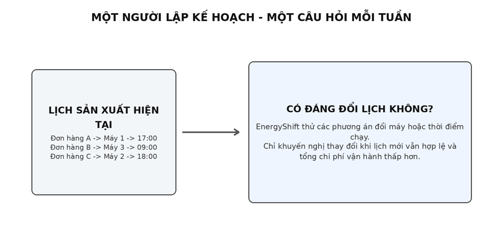
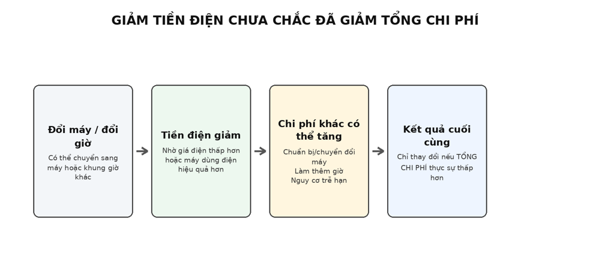
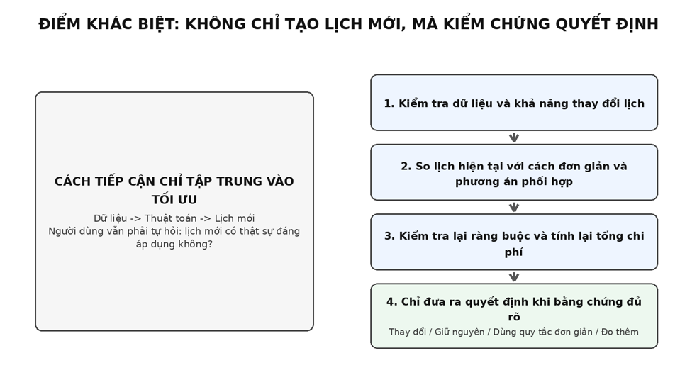
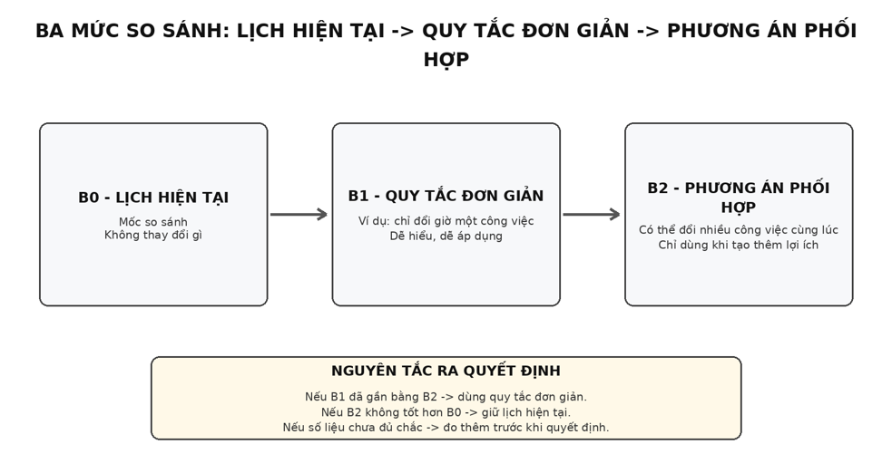
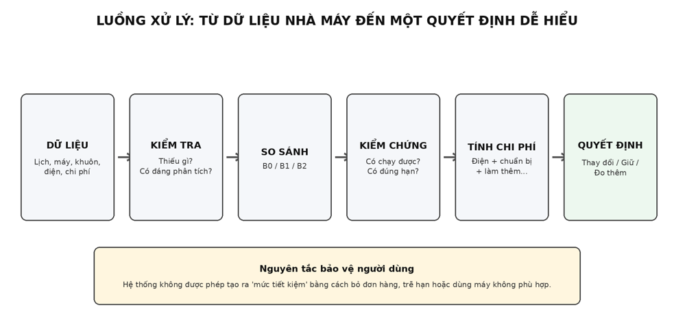
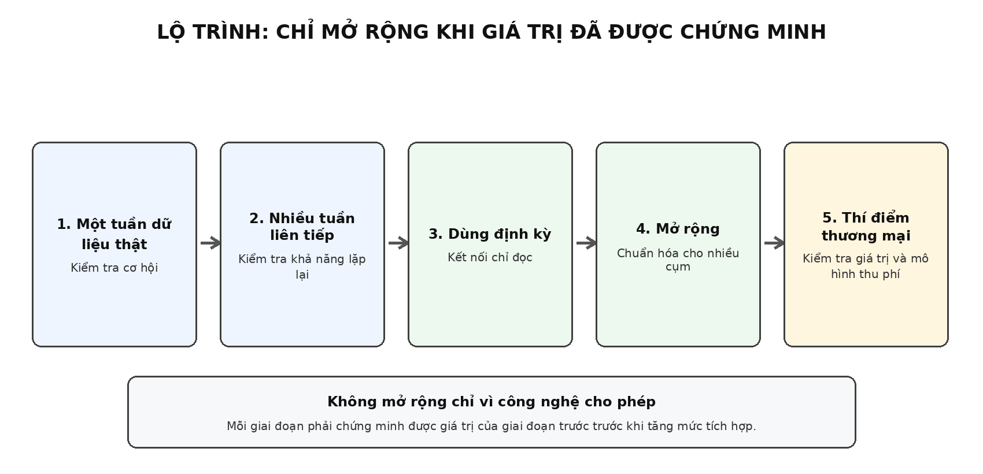

AISC’26 | EnergyShift VN 

**TRƯỜNG ĐẠI HỌC CÔNG NGHỆ THÔNG TIN KHOA HỆ THỐNG THÔNG TIN BAN TỔ CHỨC AISC'26** 

## **THUYẾT MINH DỰ ÁN** 

# **ENERGYSHIFT VN** 

**Hệ thống hỗ trợ quyết định điều chỉnh lịch sản xuất nhằm giảm tổng chi phí vận hành** 

_“Lịch sản xuất tuần này có đáng đổi để giảm tổng chi phí vận hành không?”_ 

**THAY ĐỔI LỊCH  |  GIỮ LỊCH HIỆN TẠI  |  DÙNG QUY TẮC ĐƠN GIẢN  |  ĐO THÊM TRƯỚC KHI QUYẾT ĐỊNH** 

Chủ đề: Ý tưởng Kinh doanh Số, dựa trên dữ liệu (Data-Driven Business Ideas) 

1 

AISC’26 | EnergyShift VN 

### **PHẦN I. THÔNG TIN CHUNG** 

#### **1. Tên đội thi** 

##### **<mark>[ĐIỀN TÊN ĐỘI]</mark>** 

#### **2. Chủ đề đăng ký** 

Ý tưởng Kinh doanh Số, dựa trên dữ liệu (Data-Driven Business Ideas) 

#### **3. Thông tin thành viên** 

|**Thành viên**|**Họ tên**|**MSSV**|**Khoa**|**Trường**|**Email**|**Ngày sinh**|
|---|---|---|---|---|---|---|
|Thành viên 1|[Điền]|[Điền]|[Điền]|[Điền]|[Điền]|[Điền]|
|Thành viên 2|[Điền]|[Điền]|[Điền]|[Điền]|[Điền]|[Điền]|
|Thành viên 3|[Điền]|[Điền]|[Điền]|[Điền]|[Điền]|[Điền]|
|Thành viên 4|[Điền]|[Điền]|[Điền]|[Điền]|[Điền]|[Điền]|
|Thành viên 5|[Điền]|[Điền]|[Điền]|[Điền]|[Điền]|[Điền]|

#### **4. Trưởng nhóm** 

- <mark>Họ và tên: [Điền]</mark> 

- <mark>Số điện thoại: [Điền]</mark> 

- <mark>Email: [Điền]</mark> 

### **PHẦN II. THÔNG TIN DỰ ÁN** 

#### **1. Tên dự án** 

|**Nội dung**|**Thông tin**|
|---|---|
|Tên tiếng Việt|EnergyShift VN — Hệ thống hỗ trợ quyết định điều chỉnh lịch sản xuất nhằm giảm tổng chi phí vận hành|
|Tên tiếng Anh|EnergyShift VN — Decision Support for Lower- Cost Production Scheduling|
|Lĩnh vực|Sản xuất; lập kế hoạch sản xuất; quản lý năng lượng; hỗ trợ ra quyết định dựa trên dữ liệu.|

**Câu hỏi sản phẩm cần trả lời: “Lịch sản xuất tuần này có đáng đổi để giảm tổng chi phí vận hành không?”** 

##### **1.1. Cách đọc nhanh các khái niệm xuất hiện trong đề xuất** 

Bảng dưới đây giúp người đọc hiểu trước các khái niệm sẽ xuất hiện ở những phần sau. Mục đích không phải để yêu cầu Ban giám khảo ghi nhớ thuật ngữ, mà để toàn bộ đề xuất có một cách gọi thống nhất và dễ theo dõi. 

|**Khái niệm trong đề xuất**|**Hiểu đơn giản là gì?**|**Vì sao cần?**|
|---|---|---|
|**B0 - Lịch hiện tại**|Lịch nhà máy đang dùng hoặc đã dùng trong tuần được kiểm tra.|Là mốc thực tế để mọi phương án mới phải chứng minh tốt hơn.|
|**B1 - Quy tắc đơn giản**|Một thay đổi dễ hiểu, ví dụ chuyển một công việc sang giờ khác nếu vẫn đúng hạn.|Kiểm tra xem có cần dùng cách tính phức tạp hay không.|
|**B2 - Phương án phối hợp**|Xem xét đồng thời nhiều công việc, máy và khung giờ để tìm một cách sắp xếp tốt hơn.|Chỉ có ý nghĩa nếu tạo thêm lợi ích so với B1.|
|**Ràng buộc**|Những điều bắt buộc phải đúng: đủ hàng, đúng hạn, đúng máy, không chồng lịch, đủ thời gian chuyển đổi.|Ngăn hệ thống tạo ra một lịch rẻ trên giấy nhưng không chạy được ngoài xưởng.|
|**Kiểm tra độc lập**|Một bước kiểm tra tách khỏi bước tìm phương án.|Tránh để công cụ tạo lịch tự đánh giá chính kết quả của mình.|

|**Khái niệm trong đề xuất**|**Hiểu đơn giản là gì?**|**Vì sao cần?**|
|---|---|---|
|**Tổng chi phí vận hành**|Tiền điện cộng các chi phí phát sinh có dữ liệu đáng tin cậy, như chuyển đổi hoặc làm thêm giờ.|Giúp tránh trường hợp giảm tiền điện nhưng tổng chi phí lại tăng.|
|**Ba mức THẤP / CƠ SỞ / CAO**|Tính lại kết quả khi một số số liệu đầu vào chưa chắc chắn.|Nếu kết luận thay đổi theo mức giả định, hệ thống yêu cầu đo thêm thay vì khuyến nghị vội.|
|**ERP / MES / APS**|Các nhóm hệ thống doanh nghiệp dùng để quản lý nguồn lực, vận hành xưởng hoặc lập lịch nâng cao.|EnergyShift đọc dữ liệu từ hệ thống hiện có và không thay thế hệ thống đã giải quyết tốt cùng bài toán.|

Ghi nhớ ngắn: EnergyShift không bán một “thuật toán”. Sản phẩm đưa ra một quyết định có bằng chứng: nên đổi lịch, nên giữ nguyên, chỉ cần quy tắc đơn giản, hay cần đo thêm trước khi quyết định. 

#### **2. Bối cảnh và bài toán** 

##### **2.1. Bối cảnh** 

Trong sản xuất theo lô, người lập kế hoạch sản xuất phải quyết định đơn hàng nào chạy trên máy nào, chạy vào thời điểm nào, sắp xếp thứ tự ra sao và điều chỉnh kế hoạch thế nào khi có thay đổi. Một tin tuyển dụng chuyên viên kế hoạch sản xuất tại Việt Nam mô tả trực tiếp các công việc này: lập kế hoạch theo ngày/tuần, cân đối năng lực sản xuất, điều chỉnh lịch và giảm thời gian chuyển đổi dây chuyền [6]. 

Chi phí của cùng một tập đơn hàng có thể thay đổi theo cách sắp lịch. Giá điện sản xuất tại Việt Nam thay đổi theo khung giờ; theo Quyết định 1279/QĐ-BCT, nhóm sản xuất từ 22 kV đến dưới 110 kV có mức 1.190 đồng/kWh vào giờ thấp điểm, 1.833 đồng/kWh vào giờ bình thường và 3.398 đồng/kWh vào giờ cao điểm [1]. EVN cũng công bố việc áp dụng giá điện theo thời gian trong ngày đối với các nhóm khách hàng đủ điều kiện [10]. 

Bên cạnh thời điểm chạy máy, đặc điểm máy và quy trình cũng ảnh hưởng đến mức tiêu thụ điện của quá trình ép phun nhựa (injection moulding) [2]. Vì vậy, một lịch sản xuất “chạy được” chưa chắc đã là lịch có tổng chi phí vận hành tốt nhất. 

#### MOT NGUOI LAP KE HOACH - MOT CAU HOI MOI TUAN 

AISC’26 | EnergyShift VN 

- Có dữ liệu điện và chi phí đủ để tính toán, hoặc ít nhất đủ để ước lượng trong một khoảng hợp lý. 

- Hệ thống hiện có chưa trả lời tốt câu hỏi: “Có đáng đổi lịch này để giảm tổng chi phí hay không?” 

Một trường hợp được doanh nghiệp công bố tại Việt Nam cho thấy cùng một loại khuôn/sản phẩm có thể có hơn một lựa chọn máy ép phù hợp, cụ thể là máy 160 tấn hoặc 200 tấn [7]. EnergyShift không suy rộng điều này cho mọi nhà máy; hệ thống chỉ cho phép đổi máy khi quan hệ máy – công việc đã được xác nhận. 

##### **Ví dụ thực tế có chú thích nguồn [7]** 

Seawin Industrial công bố một trường hợp thử khuôn 8 lòng cho sản phẩm vòi xịt tinh chất, trong đó khuôn này thường được chạy trên máy ép 160 tấn hoặc 200 tấn và doanh nghiệp có cả hai loại máy. Điều quan trọng đối với EnergyShift không phải là “máy nào tiết kiệm điện hơn”, mà là bằng chứng cho thấy trong một số trường hợp có thể tồn tại hơn một lựa chọn máy hợp lệ cho cùng một khuôn/sản phẩm. 

Cách EnergyShift dùng bằng chứng này: hệ thống không tự suy đoán mọi khuôn đều đổi máy được. Trong dữ liệu của từng nhà máy, chỉ những cặp công việc-khuôn-máy đã được xác nhận mới được phép đưa vào phương án mới. 

#### **3. Mục tiêu của đề tài** 

##### **3.1. Mục tiêu tổng quát** 

Xây dựng một hệ thống hỗ trợ người lập kế hoạch kiểm tra xem lịch sản xuất hiện tại có đáng thay đổi hay không, dựa trên dữ liệu thực tế, các ràng buộc bắt buộc và tổng chi phí vận hành. 

##### **3.2. Mục tiêu cụ thể** 

**1.** Dựng lại lịch hiện tại làm mốc so sánh, bảo đảm giữ nguyên các đơn hàng và sản lượng cần hoàn thành. 

**2.** Kiểm tra dữ liệu có đủ tin cậy và nhà máy có đủ khả năng thay đổi lịch trước khi thực hiện tính toán sâu. 

**3.** So sánh ba mức: lịch hiện tại; một quy tắc đơn giản; và một phương án phối hợp nhiều công việc cùng lúc. 

**4.** Kiểm tra lại độc lập xem lịch đề xuất có thực sự hợp lệ và tính lại tổng chi phí bằng một cách tính riêng. 

**5.** Đưa ra kết luận dễ hiểu: thay đổi lịch, giữ lịch hiện tại, dùng quy tắc đơn giản, hoặc đo thêm dữ liệu trước khi quyết định. 

##### **3.3. Phạm vi phiên bản đầu tiên** 

Phiên bản đầu tiên làm việc trên dữ liệu lịch sử của một cụm sản xuất trong một khoảng thời gian cụ thể. Hệ thống chỉ hỗ trợ ra quyết định; không tự điều khiển máy và không thay thế hệ thống quản lý sản xuất hiện có. 

#### **4. Tính cấp thiết, điểm khác biệt và cơ sở khoa học** 

##### **4.1. Vì sao vấn đề này đáng giải quyết?** 

Có ba lý do chính khiến lịch sản xuất có thể tạo ra chênh lệch chi phí: 

- Giá điện thay đổi theo thời điểm [1], [10]. 

- Mức tiêu thụ điện có thể khác nhau theo loại máy và cách vận hành [2]. 

- Đổi máy, đổi thứ tự hoặc đổi khung giờ có thể kéo theo thêm thời gian chuẩn bị, làm 

- thêm giờ hoặc rủi ro trễ hạn [6]. 

Cơ sở học thuật cũng đã cho thấy việc kết hợp lựa chọn máy và thời điểm sản xuất với giá điện theo thời gian có thể tạo ra giá trị kinh tế khi điều kiện phù hợp [3]. EnergyShift không dùng mức tiết kiệm của nghiên cứu khác làm cam kết; mọi so sánh đều phải tính lại trên dữ liệu của nhà máy. 

Ngoài ra, chất lượng dữ liệu là điều kiện quan trọng khi triển khai các hệ thống lập kế hoạch nâng cao [4], và các nghiên cứu trong ngành ép phun cũng nhấn mạnh việc tổ chức, liên kết dữ liệu phục vụ quyết định sản xuất [5]. Do đó, EnergyShift kiểm tra dữ liệu trước khi đưa ra khuyến nghị. 

##### **4.1.1. Ba ví dụ giúp nhìn thấy cơ chế tạo ra chênh lệch chi phí** 

Ví dụ 1 - Cùng một lượng điện nhưng khác thời điểm sử dụng. Theo Quyết định 1279/QĐBCT [1], ở nhóm sản xuất từ 22 kV đến dưới 110 kV, giá thấp điểm là 1.190 đồng/kWh và giá cao điểm là 3.398 đồng/kWh. Nếu cùng tiêu thụ 100 kWh, riêng tiền điện minh họa sẽ là 119.000 đồng ở thấp điểm và 339.800 đồng ở cao điểm, chênh 220.800 đồng. Đây chỉ là ví dụ về tín hiệu giá; EnergyShift không coi 220.800 đồng là “mức tiết kiệm” nếu việc chuyển thời gian làm phát sinh chi phí khác hoặc không khả thi. 

Ví dụ 2 - Chọn máy khác có thể làm thay đổi mức điện tiêu thụ. Nghiên cứu của Wilhøft & Ricard [2] cho thấy đặc điểm máy và đặc điểm quá trình ép phun có liên quan đến mức tiêu thụ năng lượng. Vì vậy, với một công việc có nhiều máy phù hợp, việc đổi máy có thể làm thay đổi cả thời gian chạy lẫn điện năng. EnergyShift chỉ dùng số đo hoặc ước tính đã được kiểm chứng của chính nhà máy, không suy ra rằng máy lớn hơn hay nhỏ hơn luôn tốt hơn. 

Ví dụ 3 - Đổi lịch không chỉ là bài toán điện. Mô tả công việc của một chuyên viên kế hoạch sản xuất tại Việt Nam [6] bao gồm lập kế hoạch ngày/tuần, đánh giá năng lực, điều chỉnh lịch và giảm thời gian chuyển đổi. Điều này cho thấy một thay đổi lịch phải được cân nhắc cùng năng lực máy, trình tự và thời gian chuyển đổi - đúng với câu hỏi mà EnergyShift đang giải quyết. 

##### **4.1.2. Bản đồ bằng chứng chính** 

|**Nguồn**|**Bằng chứng dùng trong đề xuất**|**Điều nguồn này không được dùng** **để khẳng định**|
|---|---|---|
|**[1] Bộ Công Thương**|Giá điện sản xuất khác nhau theo cấp điện áp và khung giờ.|Không chứng minh EnergyShift chắc chắn tiết kiệm một tỷ lệ cố định.|
|**[2] Nghiên cứu ép phun 2026**|Đặc điểm máy và quá trình ảnh hưởng đến mức tiêu thụ năng lượng.|Không chứng minh một loại máy cụ thể luôn tiết kiệm hơn.|
|**[3] Nghiên cứu lập lịch có xét giá** **điện**|Việc phối hợp lựa chọn máy/thời điểm với giá điện có cơ sở khoa học.|Không thể lấy nguyên mức tiết kiệm của nghiên cứu để áp cho nhà máy Việt Nam.|
|**[4], [5] Nghiên cứu dữ liệu và lập** **kế hoạch**|Chất lượng, liên kết và mục đích sử dụng dữ liệu là điều kiện quan trọng trước khi tối ưu.|Không chứng minh dữ liệu của mọi nhà máy đều sẵn sàng.|

|**Nguồn**|**Bằng chứng dùng trong đề xuất**|**Điều nguồn này không được dùng** **để khẳng định**|
|---|---|---|
|**[6] Mô tả công việc tại Việt Nam**|Người lập kế hoạch thực sự phải cân năng lực, lịch và chuyển đổi.|Không định lượng mức chi phí hay số giờ linh hoạt.|
|**[7] Trường hợp doanh nghiệp tại** **Việt Nam**|Một khuôn/sản phẩm có thể có hơn một lựa chọn máy trong một trường hợp cụ thể.|Không suy rộng rằng mọi khuôn đều có nhiều máy phù hợp.|
|**[8], [9] Tài liệu sản phẩm hiện có**|Thị trường đã có lập lịch nâng cao và theo dõi năng lượng.|Vì vậy EnergyShift không tuyên bố chức năng lập lịch hay theo dõi năng lượng là hoàn toàn mới.|

##### **4.2. Điểm khác biệt của EnergyShift** 

EnergyShift không đặt điểm mới ở việc phát minh một thuật toán lập lịch hoàn toàn mới. Điểm khác biệt nằm ở cách tổ chức quyết định để người dùng biết một thay đổi có thật sự đáng thực hiện hay không. 

- Bắt đầu từ lịch hiện tại của nhà máy, không bắt đầu từ một lịch “tối ưu” do hệ thống tự tạo. 

- Luôn thử một quy tắc đơn giản trước; nếu cách đơn giản đã đủ tốt thì không cần phương pháp phức tạp. 

- Mỗi khuyến nghị phải vượt qua hai câu hỏi: “Có chạy được không?” và “Có thật sự có lợi không?”. 

- Cho phép kết luận “giữ nguyên” hoặc “đo thêm”, thay vì bắt buộc phải tạo ra một thay đổi. 

#### DIEM KHAC BIET: KHONG CHI TAO LICH MOI, MA KIEM CHUNG QUYET DINH 

BA MUC SO SANH: LICH HIEN TAI -> QUY TAC DON GIAN -> PHUONG AN PHOI HOP 

|**Phương án**|**Điều gì thay đổi?**|**Ảnh hưởng minh họa**|**Kết luận**|
|---|---|---|---|
|**B1 - Quy tắc đơn giản**|Chuyển một công việc tiêu thụ 100 kWh từ giờ cao điểm sang thấp điểm.|Tiền điện có thể giảm 220.800 đồng theo chênh lệch giá của ví dụ [1]. Nếu phát sinh thêm 150.000 đồng chuyển đổi và 100.000 đồng làm thêm giờ, tổng chi phí lại tăng 29.200 đồng.|Không đổi chỉ vì điện rẻ hơn.|
|**B2 - Phương án phối hợp**|Sắp lại đồng thời hai hoặc ba công việc để tránh chồng máy và tránh làm thêm giờ.|Nếu sau khi tính đủ chi phí, phương án vẫn thấp hơn B0 và tốt hơn B1, đồng thời tất cả điều kiện vận hành đều đạt, B2 mới tạo giá trị tăng thêm.|Có thể khuyến nghị THAY ĐỔI.|

Điểm mấu chốt của ví dụ: EnergyShift không cố chứng minh “tối ưu luôn tốt”. Hệ thống phải chứng minh rằng một thay đổi vừa chạy được ngoài xưởng, vừa giảm tổng chi phí sau khi tính đủ các tác động có dữ liệu. 

##### **4.4. Khả năng triển khai về mặt kỹ thuật** 

Về mặt triển khai, nhóm có thể dùng các bộ giải bài toán lập lịch có ràng buộc như CP-SAT hoặc MILP để tạo phương án B2. Đây chỉ là công cụ tính toán phía sau; người dùng không cần hiểu thuật toán để sử dụng hệ thống. 

Mô hình phải tôn trọng các yêu cầu cơ bản: thời điểm sẵn sàng, hạn hoàn thành, máy phù hợp, thời gian gia công, lịch bảo trì, không chồng lịch, thời gian chuẩn bị/chuyển đổi và các nguồn lực dùng chung đã khai báo. 

#### **5. Các giải pháp hiện nay và khoảng trống còn lại** 

EnergyShift không giả định thị trường chưa có công cụ lập kế hoạch. Các doanh nghiệp có thể đang dùng nhiều cách khác nhau. Bảng dưới đây tập trung vào câu hỏi: phương án hiện có mạnh ở đâu, và EnergyShift chỉ còn giá trị ở trường hợp nào? 

|**Cách làm hiện nay**|**Điểm mạnh**|**Khoảng trống trong một số** **trường hợp**|**Vai trò của EnergyShift**|
|---|---|---|---|
|Excel hoặc kinh nghiệm của người lập kế hoạch|Linh hoạt, gần thực tế, chi phí công cụ thấp.|Khó so sánh có hệ thống nhiều máy, nhiều khung giờ và nhiều loại chi phí cùng lúc.|Dùng lịch hiện tại và quy tắc đơn giản làm mốc, chỉ đề xuất thay đổi khi có bằng chứng rõ.|

###### LUONG XU LY: TU DU LIEU NHA MAY DEN MOT QUYET DINH DE HIEU 

##### **6.1.1. Từ góc nhìn người dùng, mỗi bước trả lời một câu hỏi** 

|**Bước**|**Câu hỏi người dùng cần được trả** **lời**|**Kết quả hiển thị**|
|---|---|---|
|**1. Nhận dữ liệu**|Tôi đang kiểm tra đúng tuần và đúng lịch nào?|Phạm vi tuần, công việc, máy và nguồn dữ liệu.|
|**2. Kiểm tra dữ liệu**|Dữ liệu có đủ tin để phân tích không?|Thiếu gì, sai gì, phần nào đang ước tính.|
|**3. Dựng lại lịch hiện tại**|Hệ thống có tái hiện đúng những gì nhà máy đã làm không?|Lịch B0 và chi phí B0.|
|**4. Thử B1 và B2**|Cách đơn giản đã đủ hay cần phối hợp nhiều thay đổi?|Các phương án có thể so sánh.|
|**5. Kiểm chứng**|Phương án mới có thực sự chạy được không?|Danh sách điều kiện ĐẠT / KHÔNG ĐẠT.|
|**6. Tính chi phí và độ chắc chắn**|Có thật sự đáng đổi không, và kết luận có ổn định không?|THAY ĐỔI / GIỮ / DÙNG QUY TẮC ĐƠN GIẢN / ĐO THÊM.|

##### **6.2. Nguồn dữ liệu dự kiến** 

|**Nhóm dữ liệu**|**Nội dung chính**|**Nguồn điển hình**|**Mức cần thiết**|
|---|---|---|---|
|Lịch sản xuất hiện tại|Mã công việc, máy, giờ bắt đầu/kết thúc, sản lượng|ERP/MES/APS, tệp ksế hoạch, nhật ký sản xuất|Bắt buộc|
|Đơn hàng/công việc|Sản lượng, thời điểm sẵn sàng, hạn hoàn thành, loại khuôn/sản phẩm|ERP/MRP hoặc danh sách đơn hàng|Bắt buộc|
|Thông tin máy|Mã máy, thời gian khả dụng, lịch bảo trì|MES hoặc dữ liệu gốc của nhà máy|Bắt buộc|
|Máy phù hợp với công việc/khuôn|Công việc nào có thể chạy trên máy nào|Tài liệu kỹ thuật hoặc xác nhận của nhà máy|Bắt buộc|
|Thời gian gia công|Thời lượng theo từng cặp công việc - máy|Số liệu lịch sử hoặc ước tính đã được xác nhận|Bắt buộc|
|Thời gian chuẩn bị/chuyển đổi|Thời gian đổi khuôn, đổi nhóm sản phẩm|Nhật ký vận hành hoặc tiêu chuẩn của nhà máy|Bắt buộc nếu ảnh hưởng đáng kể|
|Điện năng|kWh theo công việc hoặc công suất theo thời gian|Công tơ, dữ liệu máy, lấy mẫu hoặc ước tính đã kiểm chứng|Đo trực tiếp hoặc ước tính|
|Biểu giá điện|Khung giờ và đơn giá|Hóa đơn, hợp đồng hoặc cấu hình biểu giá|Bắt buộc|
|Chi phí khác|Làm thêm giờ, trễ hạn, khoản phạt đã quan sát được|Quy định nội bộ hoặc hồ sơ thực tế|Chỉ dùng khi có cơ sở|

##### **6.3. Cách thu thập và kiểm tra dữ liệu** 

EnergyShift ưu tiên cách triển khai ít ảnh hưởng đến hệ thống hiện có: bắt đầu từ tệp CSV/Excel hoặc dữ liệu chỉ đọc. Không yêu cầu quyền điều khiển máy trong phiên bản đầu tiên. 

**1.** Chọn một cụm sản xuất và một giai đoạn lịch sử cụ thể. 

**2.** Nhận dữ liệu lịch, đơn hàng, máy, thời gian chuyển đổi, điện năng và biểu giá. 

**3.** Kiểm tra thiếu cột, mã trùng, sai thời gian và sai đơn vị. 

**4.** Đối chiếu mã công việc - máy - khuôn - công tơ điện. 

**5.** Tái dựng lịch hiện tại và kiểm tra xem kết quả có khớp dữ liệu thực tế không. 

**6.** Đánh dấu rõ số liệu nào là đo trực tiếp, số liệu gốc, xác nhận thủ công hay ước tính. 

Nếu thiếu một dữ liệu quan trọng, hệ thống không tự điền một con số “đẹp”. Hệ thống thu hẹp phạm vi hoặc đề nghị đo thêm đúng phần dữ liệu đang làm quyết định chưa chắc chắn. 

##### **6.3.1. Mỗi con số đều có mức độ tin cậy** 

Hai nhà máy có thể cùng cung cấp một con số “120 kWh”, nhưng một bên lấy trực tiếp từ công tơ còn một bên ước tính từ công suất máy và thời gian chạy. EnergyShift không xem hai con số này có độ tin cậy giống nhau. Vì vậy, hệ thống gắn nhãn nguồn gốc cho từng dữ liệu quan trọng. 

|**Mức tin cậy**|**Ví dụ**|**Cách hệ thống sử dụng**|
|---|---|---|
|**Đo trực tiếp**|Công tơ điện hoặc cảm biến ghi nhận theo thời gian.|Ưu tiên cao nhất trong tính chi phí.|
|**Dữ liệu gốc của hệ thống**|Lịch, máy, thời gian lấy trực tiếp từ ERP/MES/APS.|Dùng làm nguồn chính nếu cấu trúc và thời gian nhất quán.|
|**Nhà máy xác nhận**|Kỹ sư hoặc người lập kế hoạch xác nhận máy phù hợp, thời gian chuyển đổi.|Được dùng nhưng lưu rõ người/nguồn xác nhận.|
|**Ước tính đã kiểm chứng**|Ví dụ công suất trung bình x thời gian chạy, đã được đối chiếu với dữ liệu thực.|Dùng trong một khoảng hợp lý thay vì coi là tuyệt đối chính xác.|

|**Mức tin cậy**|**Ví dụ**|**Cách hệ thống sử dụng**|
|---|---|---|
|**Suy ra gián tiếp**|Tính từ nhiều giả định khi thiếu số đo trực tiếp.|Chỉ dùng thận trọng; nếu có thể làm đổi kết luận thì hệ thống yêu cầu đo thêm.|

##### **6.4. Cách tạo và kiểm chứng khuyến nghị** 

Sau khi dữ liệu đủ điều kiện, hệ thống lần lượt tính B0, B1 và B2. Mọi phương án mới đều phải được kiểm tra lại bởi một bộ kiểm tra độc lập. 

- Mỗi công việc bắt buộc xuất hiện đúng một lần. 

- Giữ nguyên sản lượng cần hoàn thành. 

- Máy được chọn phải phù hợp với công việc hoặc khuôn. 

- Không có hai công việc dùng cùng một máy trong cùng thời gian. 

- Tuân thủ thời điểm sẵn sàng, hạn hoàn thành và thời gian chuẩn bị/chuyển đổi. 

- Tôn trọng các nguồn lực dùng chung đã được khai báo. 

Một lịch không hợp lệ sẽ bị loại ngay, dù phép tính chi phí có cho ra con số thấp. 

Sau đó hệ thống tính lại tổng chi phí vận hành theo cùng một công thức cho B0, B1 và B2: 

**TỔNG CHI PHÍ VẬN HÀNH = CHI PHÍ ĐIỆN + CHI PHÍ CHUẨN BỊ/CHUYỂN ĐỔI + LÀM THÊM GIỜ + TRỄ HẠN + CÁC KHOẢN PHẠT KHÁC (chỉ khi có dữ liệu đáng tin cậy)** 

Nếu một hạn giao hàng là bắt buộc, EnergyShift coi đó là điều kiện phải thỏa, thay vì tự quy đổi việc trễ hạn thành một khoản tiền tùy ý. 

##### **6.4.1. B0 được dựng lại trước khi tìm phương án mới** 

B0 không chỉ là một tệp lịch cũ. Hệ thống phải dựng lại đúng công việc nào chạy trên máy nào, bắt đầu/kết thúc khi nào, sản lượng bao nhiêu và các khoảng chuyển đổi liên quan. Sau đó B0 được tính chi phí bằng đúng cùng một cách tính sẽ dùng cho B1 và B2. Nếu không tái dựng được B0, mọi tuyên bố “phương án mới tốt hơn” đều thiếu mốc đối chứng và hệ thống phải dừng. 

##### **6.4.2. B1 kiểm tra xem một cách đơn giản có đủ tốt không** 

B1 chỉ thực hiện các thay đổi dễ giải thích, ví dụ dời một công việc sang một khung giờ khác hoặc đổi sang một máy đã được xác nhận phù hợp, với điều kiện không ảnh hưởng các công việc còn lại. Nếu B1 đã cho kết quả gần bằng B2, EnergyShift khuyến nghị dùng B1 vì cách đơn giản thường dễ triển khai và dễ kiểm soát hơn. 

##### **6.4.3. B2 tìm phương án phối hợp như thế nào?** 

Khi nhiều công việc cùng tranh chấp máy, khuôn hoặc thời gian, thử từng thay đổi riêng lẻ có thể bỏ sót một phương án tốt. B2 dùng một công cụ tìm kiếm có ràng buộc để xem xét nhiều cách phân công và sắp thứ tự, nhưng loại ngay các cách vi phạm điều kiện bắt buộc. Trong triển khai, nhóm có thể dùng CP-SAT hoặc MILP - đây là tên các phương pháp chuẩn để giải bài toán nhiều lựa chọn và nhiều điều kiện; chúng chỉ là “động cơ tính toán” phía sau, không phải phần người dùng phải hiểu. 

|**Nếu chỉ có...**|**Cách hệ thống xử lý**|**Vì sao**|
|---|---|---|
|**Một công việc có thể dời giờ mà** **không ảnh hưởng gì khác**|B1 thường đủ.|Không cần dùng cách tính phức tạp.|
|**Nhiều công việc cùng dùng chung** **máy/khuôn và ảnh hưởng lẫn** **nhau**|B2 xem xét phối hợp nhiều thay đổi cùng lúc.|Thay đổi một công việc có thể làm thay đổi khả năng của công việc khác.|
|**Một phương án có chi phí thấp** **nhưng trễ hạn hoặc dùng sai máy**|Loại ngay ở bước kiểm tra độc lập.|Chi phí thấp không có ý nghĩa nếu lịch không chạy được.|
|**B2 chỉ tốt hơn B1 rất ít**|Ưu tiên B1 hoặc để quản lý xem xét ngưỡng lợi ích.|Lợi ích nhỏ có thể không đáng với công sức thay đổi lịch.|

##### **6.4.4. Vì sao bộ kiểm tra phải độc lập?** 

Nếu cùng một bộ tính toán vừa tạo lịch vừa tự kết luận lịch đó hợp lệ và rẻ hơn, một lỗi mô hình có thể đi qua toàn bộ quy trình mà không bị phát hiện. Vì vậy EnergyShift tách ba việc: tạo phương án, kiểm tra tính hợp lệ, và tính lại chi phí. Chỉ khi cả ba kết quả thống nhất, khuyến nghị mới được hiển thị cho người dùng. 

|**Điều kiện kiểm tra**|**Ví dụ sai**|**Hệ thống phải làm gì**|
|---|---|---|
|**Đủ sản lượng**|Một công việc bị bỏ khỏi lịch để giảm chi phí.|Loại phương án.|

|**Điều kiện kiểm tra**|**Ví dụ sai**|**Hệ thống phải làm gì**|
|---|---|---|
|**Đúng máy**|Khuôn/công việc được chuyển sang máy chưa được xác nhận phù hợp.|Loại phương án.|
|**Không chồng lịch**|Hai công việc cùng dùng một máy trong cùng thời gian.|Loại phương án.|
|**Đúng hạn**|Phương án rẻ hơn nhưng giao hàng sau hạn bắt buộc.|Loại phương án.|
|**Đủ thời gian chuyển đổi**|Lịch mới không chừa đủ thời gian thay khuôn/chuyển nhóm sản phẩm.|Loại hoặc tính lại lịch.|
|**Chi phí được tính cùng một cách**|B0 và B2 dùng hai công thức chi phí khác nhau.|Không cho phép so sánh.|

##### **6.5. Cách xử lý khi số liệu chưa chắc chắn** 

Với các số liệu chưa chắc chắn, ví dụ điện năng theo từng công việc hoặc thời gian chuẩn bị máy, hệ thống tính lại theo ba mức THẤP / CƠ SỞ / CAO. Nếu kết luận thay đổi khi số liệu thay đổi trong phạm vi hợp lý, hệ thống không ép người dùng phải chọn một lịch mới mà trả về: ĐO THÊM TRƯỚC KHI QUYẾT ĐỊNH. 

Kết quả “đo thêm” phải nói rõ cần đo gì, tại máy hoặc công việc nào, và dữ liệu nào đang ảnh hưởng nhiều nhất đến quyết định. 

##### **6.5.1. Ví dụ khi nào phải “đo thêm trước khi quyết định”** 

Giả sử điện năng của một công việc chưa được đo trực tiếp mà chỉ ước tính. EnergyShift không chọn một con số duy nhất rồi coi như chắc chắn. Hệ thống có thể tính ba mức hợp lý như sau: 

|**Kịch bản**|**Giả định minh họa**|**Kết quả so với lịch hiện** **tại**|**Ý nghĩa**|
|---|---|---|---|
|**THẤP**|Mức điện/chi phí ở đầu thấp của khoảng ước tính.|Phương án mới giảm chi phí.|Có vẻ nên đổi.|
|**CƠ SỞ**|Mức ước tính trung tâm.|Phương án mới chỉ tốt hơn rất ít.|Cần thận trọng.|
|**CAO**|Mức điện/chi phí ở đầu cao của khoảng ước tính.|Phương án mới không còn lợi.|Không nên đổi nếu chưa đo thêm.|

Khi ba kịch bản cho ba kết luận khác nhau, EnergyShift không chọn kết luận thuận lợi nhất. Hệ thống trả về “ĐO THÊM TRƯỚC KHI QUYẾT ĐỊNH” và chỉ ra dữ liệu nào cần đo thêm. Đây là một cơ chế kiểm soát rủi ro, không phải lỗi của hệ thống. 

##### **6.6. Những gì người dùng nhìn thấy** 

Bảng điều khiển được sắp xếp theo thứ tự ra quyết định, không theo thứ tự thuật toán: 

- Lịch đang kiểm tra và chất lượng dữ liệu. 

- Dữ liệu nào còn thiếu hoặc chưa chắc chắn. 

- Kết luận chính: thay đổi, giữ nguyên, dùng quy tắc đơn giản hoặc đo thêm. 

- So sánh lịch hiện tại với lịch đề xuất bằng biểu đồ tiến độ (Gantt). 

- Danh sách ràng buộc đã đạt/chưa đạt. 

- Biểu đồ cho thấy tổng chi phí thay đổi do điện, chuyển đổi, làm thêm giờ và các khoản khác. 

- Giải thích cụ thể từng công việc nào thay đổi, đổi vì lý do gì và ảnh hưởng chi phí ra sao. 

##### **6.6.1. Mỗi phần trên bảng điều khiển trả lời một câu hỏi** 

|**Phần hiển thị**|**Câu hỏi mà người dùng đang cần trả lời**|
|---|---|
|**Tổng quan tuần và dữ liệu**|Tôi đang kiểm tra đúng tuần, đúng máy và đúng nguồn dữ liệu chưa?|
|**Mức độ sẵn sàng**|Còn thiếu dữ liệu hoặc ràng buộc nào quan trọng?|
|**Kết luận chính**|Có đáng đổi lịch không?|
|**So sánh lịch hiện tại - lịch đề xuất**|Cụ thể công việc nào thay đổi, thay đổi ở đâu?|
|**Chứng nhận điều kiện vận hành**|Lịch mới có thực sự chạy được không?|
|**Biểu đồ chi phí**|Tiền giảm hoặc tăng đến từ điện, chuyển đổi, làm thêm giờ hay khoản nào?|
|**Độ chắc chắn / kế hoạch đo thêm**|Nếu chưa chắc, cần đo thêm gì để ra quyết định?|

##### **6.7. Chỉ số đánh giá hiệu quả** 

|**Nhóm chỉ số**|**Cách đánh giá**|
|---|---|
|Tính hợp lệ|Không vi phạm ràng buộc bắt buộc; đủ sản lượng; đúng hạn; không chồng máy; máy phù hợp.|

|**Nhóm chỉ số**|**Cách đánh giá**|
|---|---|
|Chất lượng dữ liệu|Tái dựng được lịch hiện tại; mức đầy đủ của dữ liệu; mức tin cậy của số liệu điện và các ràng buộc.|
|Hiệu quả kinh tế|Chi phí của B0/B1/B2; chênh lệch tiền điện; chênh lệch chi phí chuẩn bị/làm thêm giờ; chênh lệch tổng chi phí.|
|Chất lượng quyết định|Số công việc phải thay đổi; số phương án bị loại; mức ổn định của kết luận khi số liệu thay đổi.|

##### **6.7.1. Khi nào hệ thống mới được phép khuyến nghị THAY ĐỔI?** 

Một khuyến nghị “THAY ĐỔI LỊCH” chỉ xuất hiện khi đồng thời đạt tất cả điều kiện dưới đây: 

- Tất cả ràng buộc bắt buộc đều đạt: đủ sản lượng, đúng hạn, đúng máy, không chồng lịch và đủ thời gian chuyển đổi. 

- Tổng chi phí vận hành của phương án mới thấp hơn lịch hiện tại khi tính bằng cùng một cách. 

- Nếu quy tắc đơn giản B1 đã gần bằng B2, hệ thống không ép dùng B2 mà ưu tiên cách đơn 

giản. 

- Kết luận không bị đảo chiều trong phạm vi số liệu hợp lý; nếu bị đảo chiều, hệ thống yêu cầu đo thêm. 

- Người dùng có thể truy lại nguồn dữ liệu và lý do của từng thay đổi chính. 

Nói cách khác, mục tiêu của EnergyShift không phải tạo ra càng nhiều thay đổi càng tốt, mà là chỉ đề xuất thay đổi khi bằng chứng đủ mạnh để người lập kế hoạch có thể chịu trách nhiệm cho quyết định đó. 

##### **6.8. Ưu điểm và hạn chế** 

Ưu điểm chính: 

- Dễ hiểu: người dùng nhận một quyết định và lý do, không phải đọc đầu ra kỹ thuật. 

- Không ép thay đổi: giữ lịch hiện tại cũng là một kết quả hợp lệ. 

- Không dùng phương pháp phức tạp khi cách đơn giản đã đủ tốt. 

- Mọi phương án đều được kiểm tra lại về vận hành và chi phí.  

- Có thể bắt đầu từ dữ liệu lịch sử, không cần thay đổi ngay hệ thống đang chạy. 

Ba hạn chế cần thừa nhận: 

|**Hạn chế**|**Cách xử lý**|
|---|---|
|Cần lịch sử sản xuất và ràng buộc đủ tin cậy.|Kiểm tra dữ liệu trước khi phân tích; thiếu dữ liệu quan trọng thì dừng hoặc thu hẹp phạm vi.|
|Dữ liệu điện và thời gian chuyển đổi có thể chưa đầy đủ.|Dùng đo trực tiếp, lấy mẫu hoặc khoảng ước lượng; nếu kết luận chưa ổn định thì yêu cầu đo thêm.|
|Phiên bản đầu tiên chỉ giải quyết một phạm vi hẹp.|Mở rộng dần sau khi đã chứng minh giá trị trên dữ liệu thực tế.|

##### **6.9. Khả năng mở rộng và thương mại hóa** 

Sản phẩm khởi điểm là một lần “kiểm tra cơ hội từ dữ liệu lịch sử” cho một cụm sản xuất và một giai đoạn cụ thể. Khách hàng nhận được một gói bằng chứng gồm: mức độ sẵn sàng dữ liệu, so sánh lịch, xác nhận ràng buộc, chênh lệch chi phí và kết luận nên làm gì tiếp theo. Mô hình doanh thu dự kiến gồm: 

- Phí thí điểm/chẩn đoán ban đầu cho lần kiểm tra cơ hội đầu tiên. 

- Phí sử dụng định kỳ theo cụm sản xuất nếu giá trị lặp lại qua nhiều tuần. 

- Phí triển khai riêng nếu khách hàng cần kết nối hoặc chuyển đổi dữ liệu đặc thù. 

Khả năng mở rộng không dựa vào giả định một công thức dùng được cho mọi nhà máy. Sản phẩm mở rộng bằng cách chuẩn hóa cách nhận dữ liệu, cách mô tả ràng buộc, cách tính chi phí và cách lưu lại lịch sử quyết định. 

#### **7. Kết quả dự kiến** 

##### **7.1. Loại sản phẩm** 

- ☑ Nguyên mẫu (prototype) 

- ☑ Bảng điều khiển 

- ☑ Khác: Hệ thống hỗ trợ ra quyết định sản xuất dựa trên dữ liệu 

- ☐ Ứng dụng di động 

- ☐ Mô hình trí tuệ nhân tạo độc lập 

##### **7.2. Sản phẩm dự kiến hoàn thành** 

- Tiếp nhận và kiểm tra dữ liệu lịch sử. 

- Tái dựng lịch hiện tại B0. 

- So sánh B0/B1/B2. 

- Kiểm tra độc lập tính hợp lệ của lịch đề xuất. 

- Tính lại tổng chi phí vận hành. 

- Kiểm tra độ ổn định của quyết định theo ba mức số liệu. 

- Hiển thị kết luận, biểu đồ tiến độ, biểu đồ chi phí và gợi ý cần đo thêm. 

##### **7.3. Kịch bản trình diễn** 

#### **MỘT CỤM SẢN XUẤT -> MỘT TUẦN -> MỘT LỊCH HIỆN TẠI -> 2-3 THAY ĐỔI CỤ THỂ -> KIỂM TRA RÀNG BUỘC -> SO SÁNH TỔNG CHI PHÍ -> MỘT QUYẾT ĐỊNH** 

Dữ liệu giả lập chỉ được dùng để kiểm tra cách hệ thống hoạt động. Mọi con số minh họa phải được ghi rõ là số liệu minh họa, không được trình bày như kết quả tiết kiệm của một nhà máy thực tế. 

##### **7.4. Kế hoạch kiểm chứng giá trị trên dữ liệu thực tế** 

Sau nguyên mẫu kỹ thuật, bước có giá trị nhất không phải là bổ sung thêm thuật toán mà là chạy toàn bộ quy trình trên một tuần dữ liệu lịch sử thực tế. Khi đó nhóm sẽ kiểm tra bốn câu hỏi: 

- Hệ thống có tái dựng đúng lịch nhà máy đang dùng hay không? 

- B1 và B2 có tạo ra phương án hợp lệ trong dữ liệu thật hay không? 

- Sau khi tính đúng biểu giá và chi phí quan sát được, quyết định có còn lợi về kinh tế hay không? 

- Người lập kế hoạch có hiểu, chấp nhận hoặc bác bỏ khuyến nghị vì lý do gì? 

23 

##### LO TRINH: CHI MO RONG KHI GIA TRI DA DUOC CHUNG MINH 

EnergyShift phát triển theo lộ trình tăng dần mức tích hợp. Mỗi bước chỉ được mở rộng khi bước trước đã cho thấy giá trị đủ rõ.

1. Tuần dữ liệu thực tế đầu tiên: dùng biểu giá thật, ràng buộc thật và đánh giá của người lập kế hoạch.
2. Nhiều tuần liên tiếp: kiểm tra kết quả có lặp lại hay không và đo công sức đưa dữ liệu vào hệ thống.
3. Dùng định kỳ: kết nối chỉ đọc, lưu lịch sử quyết định và theo dõi hiệu quả khuyến nghị.
4. Mở rộng: chuẩn hóa cách chuyển đổi dữ liệu và mẫu ràng buộc cho nhiều cụm sản xuất.
5. Thí điểm thương mại: kiểm tra ngưỡng giá trị đủ thuyết phục và mô hình thu phí phù hợp.

[2] Wilhøft, A., & Ricard, L. M. (2026). Closing the LCA data gap: Early prediction of injection moulding energy consumption. Journal of Cleaner Production, 565, 148574. https://doi.org/10.1016/j.jclepro.2026.148574 

[3] Park, M. J., & Ham, A. (2022). Energy-aware flexible job shop scheduling under time-of-use pricing. International Journal of Production Economics, 248, 108507. https://doi.org/10.1016/j.ijpe.2022.108507 

[4] Herrmann, J.-P., et al. (2022). An ERP Data Quality Assessment Framework for the Implementation of an APS system using Bayesian Networks. Procedia Computer Science, 200, 194–204. https://doi.org/10.1016/j.procs.2022.01.218 

[5] Sapel, P., et al. (2022). Towards digital shadows for production planning and control in injection molding. CIRP Journal of Manufacturing Science and Technology, 38, 243–251. https://doi.org/10.1016/j.cirpj.2022.05.003 

[6] XP Power Vietnam. (2026). Senior Production Planner — Job Description. CareerViet. https://careerviet.vn/en/search-job/senior-production-planner.35C8304F.html 

[7] Seawin Industrial. (2026, August 15). Pre-Transfer Trial Production for 8-Cavity PCR PP Essence Sprayer Molds | Vietnam Injection Molding. https://www.seawinindustrial.com/injection-molding-guide/pre-transfer-trialproduction-cosmetic-molds-vietnam-injection-molding/ 

[8] SAP. (2026). Production Planning and Detailed Scheduling (PP/DS) — DS Optimization / Mode Costs. https://help.sap.com/docs/SAP_S4HANA_ON-PREMISE/f899ce30af9044299d573ea30b533f1c/ 

[9] Epicor Vietnam. Advanced MES Energy Monitoring. https://www.epicor.com/vi-vn/products/manufacturingexecution-software-mes/advanced-mes/ptw-energy-monitoring/ 

[10] EVN. (2026). Bản tin EVN số 16/2026. 

https://www.evn.com.vn/userfile/User/tcdl/files/2026/4/BanTinEVNSo162026-20260428150748448.pdf 

25 

