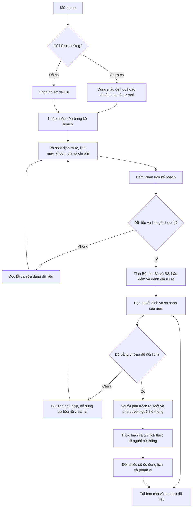

# EnergyShift — Quy trình sử dụng từ A đến Z

Phiên bản tài liệu: 19/10/2026. Đối chiếu với hệ thống sau PR #17.

Tài liệu dành cho kỹ sư lập lịch, người phụ trách sản xuất và người xem demo.
Các tên nút có thể rút gọn khi xem trên điện thoại; luồng và dữ liệu vẫn như nhau.

## 1. Hệ thống giúp người dùng làm gì?

EnergyShift nhận lịch sản xuất hiện tại và hồ sơ xưởng, kiểm tra lịch, tính chi phí
điện chạy cùng chuyển đổi đã khai báo, rồi tìm phương án điều chỉnh. Kết quả giúp
người dùng quyết định giữ lịch, dùng cách điều chỉnh đơn giản, cân nhắc lịch phối hợp
hoặc bổ sung bằng chứng trước khi đổi lịch.

Đầu ra là **khuyến nghị có điều kiện**, lịch so sánh và bằng chứng tính toán.
Hệ thống chưa tự điều khiển máy, gửi lệnh xuống xưởng hoặc thực hiện phê duyệt doanh nghiệp.

Demo hiện chưa có dữ liệu đo nhà máy để chứng minh tiết kiệm thực tế. Bộ mẫu mang
nhãn `SYNTHETIC` nghĩa là giả lập, kể cả khi kết quả tìm kiếm và phép tính chạy thật.

## 2. Bản đồ toàn bộ quy trình



Không phải lượt phân tích nào cũng đi tới thực hiện. Kết luận giữ lịch hoặc yêu
cầu đo thêm là kết quả hợp lệ của hệ thống.

## 3. Hiểu các khái niệm trước khi bắt đầu

| Thuật ngữ | Nghĩa với người sử dụng |
|---|---|
| Lô / job | Một công việc sản xuất cần bố trí lên máy trong một khoảng thời gian |
| B0 | Lịch hiện tại do người dùng cung cấp, dùng làm mốc so sánh |
| B1 | Phương án tìm bằng các thay đổi đơn lẻ đối với công việc |
| B2 | Phương án tìm bằng cách phối hợp thời điểm trong các miền máy/thứ tự có giới hạn |
| Hồ sơ xưởng | Dữ liệu tham chiếu tái sử dụng: máy, khuôn, thời gian, giá, định mức, chính sách và lịch tham chiếu |
| Định mức | Cơ sở về sản lượng, thời lượng và công suất cho công việc trên máy tương thích |
| Horizon | Khoảng thời gian mà lịch được phép xem xét |
| Setup / chuyển đổi | Thời gian và chi phí chuẩn bị/đổi khuôn theo dữ liệu đã khai báo |
| Nominal | Kết quả tại giá trị đầu vào cơ sở, trước khi xét toàn bộ các biên bất lợi |
| Ledger | Các dòng tính chi phí có thời gian, thành phần và số liệu để đối soát |
| PASS | Lịch qua các kiểm tra đã mô hình hóa; không chứng nhận mọi điều kiện thực tế |
| UNKNOWN | Chưa đủ dữ liệu để kết luận; không có nghĩa là giá trị bằng 0 |
| Input hash | Dấu vết nhận diện bộ dữ liệu dùng cho một lượt phân tích |

B2 có thể giữ lại lịch tốt nhất từ B0/B1 khi chưa tìm được lịch phối hợp tốt hơn.
Tên B2 không bảo đảm có nhiều thay đổi hoặc chi phí thấp hơn mọi lịch có thể có.

## 4. Người dùng cần chuẩn bị đầu vào gì?

### 4.1. Lần đầu thiết lập một xưởng

Người hiểu hiện trường cần rà soát các nhóm dữ liệu sau. Bộ mẫu chỉ giúp hiểu cách
nhập, không thay thế hồ sơ thật của xưởng.

| Nhóm | Cần biết | Vì sao cần |
|---|---|---|
| Máy | Mã máy, thời gian có thể chạy, điều kiện ban đầu | Tránh xếp vào máy không sẵn sàng |
| Khuôn và tương thích | Công việc chạy được trên máy nào, cần khuôn nào, trạng thái ban đầu | Tránh xung đột máy/khuôn và tính chuyển đổi |
| Định mức | Sản lượng tham chiếu, thời lượng trên từng máy, công suất trung bình | Tính thời gian và điện chạy |
| Nguồn định mức | Nguồn khai báo/đo, tài liệu tham chiếu, sai số công suất | Phân biệt giả định với bằng chứng |
| Biểu giá | Các khoảng bắt đầu/kết thúc và đơn giá điện | Tính tiền theo thời điểm chạy |
| Chi phí chuyển đổi | Phí và thời gian chuyển đổi theo hồ sơ | Tránh đề xuất chỉ rẻ về điện nhưng tốn chuyển đổi |
| Chi phí ngoài mô hình | Khoản bị loại trừ, đánh giá và biên chi phí nếu có cơ sở | Xét lợi ích sau rủi ro |
| Chính sách quyết định | Ngưỡng lợi ích và điều kiện chấp nhận | Quyết định có đáng đổi lịch không |
| Kế hoạch B0 | Các lô, máy, giờ bắt đầu, thời điểm sẵn sàng và hạn xong | Tạo mốc so sánh khả thi |

Các biểu mẫu nâng cao hỗ trợ sửa nhiều trường của hồ sơ sẵn có. Tạo danh mục
máy/khuôn hoàn toàn mới, đổi số khoảng biểu giá hoặc quy tắc chuyển đổi phức tạp
hiện vẫn cần chuẩn hóa JSON với người hiểu mô hình. Chưa có luồng tự lấy dữ liệu ERP/MES.

### 4.2. Mỗi lần lập kế hoạch sau khi đã có hồ sơ

Kỹ sư chủ yếu cập nhật bảng lô:

| Trường | Cách điền |
|---|---|
| Mã lô | Mã riêng để nhận diện công việc, không trùng trong kế hoạch |
| Mã định mức | Chọn định mức tham chiếu phù hợp, không mặc nhiên coi là mã sản phẩm đã xác thực |
| Số lượng | Sản lượng của lô đang lập lịch |
| Máy B0 | Máy dự kiến chạy trong lịch hiện tại |
| Bắt đầu | Thời điểm bắt đầu của lịch B0 |
| Sẵn sàng từ | Thời điểm sớm nhất được phép chạy |
| Hạn xong | Thời điểm muộn nhất phải hoàn thành |

Một số cột nằm trong **Hiện định mức & hạn hoàn thành**. Thu gọn phần này chỉ
ẩn cột trên màn hình, không xóa dữ liệu.

### 4.3. Quy ước và giới hạn

- Giới hạn demo: tối đa **8 lô, 3 máy, 48 giờ**; không chia một xưởng lớn thành
  các phần rồi mặc nhiên coi kết quả là lịch tối ưu toàn xưởng.
- Ngày giờ nhập bảng dùng dạng rõ ràng `YYYY-MM-DD HH:mm`, theo múi giờ `+07:00`.
  Dữ liệu JSON/CSV số đo cần giữ offset theo định dạng được yêu cầu.
- Công suất dùng **kW**, điện năng dùng **kWh**, tiền dùng **VND**; ba đơn vị này khác nhau.
- Dữ liệu trống chưa biết cần được bổ sung hoặc ghi nhận đúng trạng thái, không
  điền 0 chỉ để vượt qua kiểm tra.
- Khi đổi sản lượng, hệ thống không tự nhân thời lượng theo một công thức chưa
  được xác nhận. Cần rà soát thời lượng cho các máy tương thích.

## 5. Mở demo và nhận biết sáu mục giao diện

Mở URL demo đã triển khai hoặc địa chỉ local do người cài đặt cung cấp. Với cấu
hình local mặc định, địa chỉ là `http://127.0.0.1:8765/`.

Chưa phân tích thì hệ thống chưa có kết quả để so sánh. Bắt đầu tại khu vực nhập
kế hoạch, không diễn giải các chỗ trống là hệ thống đã tính ra 0.

| Mục trên thanh bên | Dùng vào lúc nào |
|---|---|
| Quyết định & So sánh | Đọc đề xuất, chi phí, lịch được chọn và chênh lệch |
| Tiến độ Gantt | Xem công việc, máy, thời gian và chuyển đổi của các lịch |
| Phụ tải & Biểu giá | Xem đồ thị công suất/tiền theo giờ, bảng số liệu và đối chiếu số đo |
| Ràng buộc vật lý | Xem trạng thái kiểm chứng và bằng chứng của lịch |
| Độ nhạy & Rủi ro | Đọc tác động sai số công suất và chi phí chưa chắc chắn |
| Điều chuyển đơn hàng / khu vực Nhập liệu | Chuẩn bị kế hoạch, hồ sơ, nhập bảng và dùng nhóm demo |

Có thể đổi sáng/tối. Trên màn hình nhỏ, mở menu để chuyển mục; chuyển mục không
thay thế việc lưu hồ sơ hay tải bản sao.

## 6. Luồng nhanh để xem demo lần đầu

1. Chọn một bộ dữ liệu mẫu có sẵn.
2. Mở khu vực nhập liệu, đọc các lô và hồ sơ; giữ nguyên mẫu trong lượt đầu.
3. Bấm **Phân tích kế hoạch** và chờ hoàn tất.
4. Đọc loại quyết định, phương án được chọn và lý do tại **Quyết định & So sánh**.
5. Sang Gantt để biết cụ thể lô nào đổi máy hoặc đổi giờ.
6. Sang Phụ tải & Biểu giá; rê chuột trong vùng vẽ để xem số liệu từng giờ.
7. Đọc Ràng buộc vật lý và Độ nhạy & Rủi ro trước khi diễn giải lợi ích.
8. Mở tờ trình quyết định và tải báo cáo JSON.
9. Trở lại bảng, sửa một giá trị rồi phân tích lại để quan sát tác động.

Khi trình bày, nói rõ: “Đây là kết quả tính trên dữ liệu giả lập”, kèm phạm vi
chi phí và tìm kiếm. Chưa dùng kết quả mẫu để khẳng định số tiền xưởng thật sẽ tiết kiệm.

## 7. Chuẩn bị kế hoạch bằng ba cách

### Cách A — Chọn hồ sơ rồi sửa bảng

1. Chọn hồ sơ xưởng đã lưu hoặc nạp mẫu làm cơ sở.
2. Kiểm tra tên hồ sơ và dữ liệu tham chiếu có đúng ca/xưởng không.
3. Sửa mã lô, số lượng, máy và giờ bắt đầu trên bảng.
4. Mở các cột định mức, thời điểm sẵn sàng và hạn hoàn thành khi cần.
5. Nếu đổi số lượng, cập nhật định mức/thời lượng và xác nhận thông tin lô mới
   theo yêu cầu hiển thị; rà soát mọi máy tương thích.
6. Nếu chuyển kế hoạch sang ngày khác, kiểm tra lại lịch máy, biểu giá và trạng
   thái khuôn trước khi xác nhận dời ngày.
7. Rà soát chi phí ngoài mô hình rồi bấm **Phân tích kế hoạch**.

Không đổi mã định mức chỉ để bỏ qua cảnh báo sản lượng. Mã lô mới vẫn có thể dùng
định mức cũ khi nội dung và nguồn xác nhận phù hợp.

### Cách B — Dán bảng Excel hoặc mở CSV/TSV

1. Chuẩn bị một bảng có dòng tiêu đề, mỗi dòng là một lô.
2. Trong phần nhập từ bảng, dán vùng đã copy từ Excel hoặc mở file CSV UTF-8/TSV.
   Chưa hỗ trợ đọc trực tiếp file `.xlsx`.
3. Kiểm tra phần xem trước; đối chiếu số dòng với dữ liệu gốc.
4. Ghép từng cột nguồn vào trường tương ứng. Gợi ý tên tiếng Việt/Anh là luật
   ghép cột, không phải AI đã hiểu và xác thực nội dung của xưởng.
5. Sửa cột thiếu, thời gian mơ hồ, mã không phù hợp hoặc dòng không đều.
6. Đọc và xác nhận xử lý các cột chưa ghép trước khi tiếp tục.
7. Kiểm tra lại bảng kế hoạch sau nhập rồi chạy phân tích.

Cấu hình ghép cột được nhớ theo đúng dãy tiêu đề. Khi đổi tên/thứ tự tiêu đề,
cần kiểm tra lại thay vì giả định mapping cũ vẫn đúng.

**Cột được lưu không có nghĩa là đã được tính.** Ví dụ cột “nguyên liệu thiếu”
hoặc “nhiệt độ khuôn” chưa nằm trong mô hình sẽ được giữ trong dữ liệu nguồn/bản
sao, nhưng không tự biến thành ràng buộc của solver. Kỹ sư phải đánh giá điều kiện
đó trước khi sử dụng đề xuất.

Giới hạn bảng nhập: 128 KiB, 32 cột, 4096 ký tự mỗi ô. Hệ thống không tự cắt
bớt lô vượt giới hạn để tạo một kết quả có vẻ hợp lệ.

### Cách C — JSON nâng cao

Dành cho người chuẩn hóa hồ sơ hoặc cần sửa cấu trúc chưa có biểu mẫu. Dùng đúng
contract hiện tại và giữ một bản sao trước khi sửa. Sửa JSON trực tiếp làm bảng
chuẩn bị cũ mất hiệu lực; kiểm tra lại nguồn đang dùng trước khi phân tích.

JSON đầu vào và bản sao workspace là hai loại tệp khác nhau. Không đổi đuôi hoặc
dán nguyên một bản sao workspace vào ô JSON đầu vào nếu cấu trúc không đúng.

## 8. Lưu hồ sơ, bản nháp và bản sao

| Cơ chế | Khi nào dùng | Phạm vi và điều cần nhớ |
|---|---|---|
| Hồ sơ có tên | Tái sử dụng dữ liệu xưởng | Tối đa 5 tên trên cùng trình duyệt/origin; lưu/cập nhật bằng nút |
| Bản nháp | Tiếp tục bảng đang sửa | Tự lưu sau khoảng 350 ms; reload không tự áp dụng nháp và không phục hồi quyết định cũ |
| Bản sao JSON workspace | Chuyển máy hoặc giữ toàn bộ việc chuẩn bị | Gồm dữ liệu cơ sở, bảng, nguồn nhập và thông tin liên quan; cần khôi phục và phân tích lại |
| Báo cáo JSON | Lưu kết quả một lần chạy | Gồm snapshot, dấu vết, lịch và bằng chứng; khác với bản nháp đang sửa |

Các ô thiết lập/định mức cần bấm cập nhật thì phải cập nhật trước khi trông chờ
nội dung đó xuất hiện trong bản lưu. Hồ sơ không tự đồng bộ giữa máy, trình duyệt,
địa chỉ local và địa chỉ Vercel.

Nếu storage bị chặn hoặc đầy, đọc cảnh báo và tải bản sao; luồng chuẩn bị/phân
tích vẫn có thể dùng. Máy dùng chung có thể để người khác đọc dữ liệu local;
xóa hồ sơ/nháp khi cần. Không nhập API key vào bảng, ghi chú hay file chia sẻ.

## 9. Khi bấm Phân tích kế hoạch, hệ thống làm gì?

1. Kiểm tra bảng có thay đổi chưa áp dụng không. Nếu có, tự chuẩn bị và kiểm tra
   đầu vào trước; không âm thầm chạy bản dữ liệu cũ.
2. Kiểm tra cấu trúc, giới hạn, danh mục tham chiếu, thời gian và tính nhất quán.
3. Dựng và kiểm chứng lịch B0. Lịch FAIL/UNKNOWN không được dùng để xuất một
   phép so sánh chi phí như thể lịch đó hợp lệ.
4. Tính điện chạy theo các khoảng biểu giá và chi phí chuyển đổi đã khai báo.
5. Tìm B1 bằng các thay đổi đơn lẻ trong giới hạn cấu hình.
6. Chạy B2 bằng CP-SAT trên các miền giới hạn, gồm các miền từ B0/B1 và các
   láng giềng máy/thứ tự được công bố. Không duyệt mọi lịch có thể có.
7. Hậu kiểm ứng viên bằng verifier và phép tính chi phí độc lập với mục tiêu solver.
8. Xét sai số công suất, chi phí ngoài mô hình và ngưỡng lợi ích để chọn đề xuất.
9. Hiển thị báo cáo và dấu vết gắn với đúng đầu vào của lượt chạy.

Luồng này không cần gọi OpenRouter. API model dùng cho công cụ đánh giá riêng,
chưa phải chatbot/AI tự hiểu file hay tự quyết định lịch trên giao diện.

Ngân sách B2 không phải thời gian chờ tối đa của cả yêu cầu: còn chuẩn bị, B1,
hậu kiểm, hàng đợi và khởi động backend. Khi chờ, tránh bấm gửi nhiều lần.

## 10. Đọc Quyết định & So sánh

Đọc theo thứ tự: **quyết định → lịch được chọn → lý do → phạm vi chi phí → bằng chứng**.

| Kết luận | Cách hiểu | Việc người dùng nên làm |
|---|---|---|
| `CHANGE` — Có phương án đạt ngưỡng | Có phương án vượt điều kiện quyết định trong phạm vi đánh giá | Xem thay đổi, rủi ro và điều kiện hiện trường trước khi phê duyệt |
| `USE_SIMPLE_RULE` — Ưu tiên quy tắc đơn giản | Lịch đơn giản được ưu tiên; chưa có cơ sở đủ mạnh để dùng B2 thay thế | Xem lịch được chọn thực tế và lý do lợi ích tăng thêm |
| `KEEP_CURRENT` — Giữ lịch hiện tại | Chưa tìm được phương án đạt ngưỡng trong phạm vi đã tìm | Giữ B0 nếu hiện trường vẫn phù hợp; không coi là bằng chứng B0 tối ưu toàn cục |
| `MEASURE_FIRST` — Cần bổ sung bằng chứng | Thiếu dữ liệu/rà soát để khuyến nghị đổi lịch | Bổ sung thông tin được nêu rồi chạy lại |

Các card B0/B1/B2 là đối chứng. Card có chi phí nominal thấp nhất chưa chắc là
card được đề xuất sau khi xét rủi ro. Luôn đọc nhãn **Đề xuất** và tên phương án.

Các chỉ tiêu cần phân biệt:

- **Điện + chuyển đổi mô hình:** tổng các thành phần đang được tính, không phải
  toàn bộ giá thành sản xuất hay toàn bộ hóa đơn xưởng.
- **Chênh lệch nominal:** chi phí B0 trừ chi phí phương án tại đầu vào cơ sở.
- **Tiền điện giảm:** khoản tiền từ điện chạy, không đồng nghĩa giảm tổng kWh.
- **kWh cao điểm giảm:** điện năng chuyển khỏi giờ cao điểm; không đồng nghĩa
  giảm đỉnh công suất kW hoặc đủ năng lực trạm biến áp.
- **Chi phí chuyển đổi thay đổi:** có thể tăng khi đổi lịch dù tiền điện giảm.
- **Số lô đổi lịch:** cần xem chi tiết máy/giờ để hiểu tác động vận hành.

## 11. Đọc Tiến độ Gantt

1. Chọn lịch B0/B1/B2 hoặc chế độ so sánh được cung cấp.
2. Đọc hàng máy và trục thời gian; kiểm tra đúng ngày và khoảng lập lịch.
3. Xác định những lô đổi máy, đổi giờ và các khoảng chuyển đổi.
4. Đối chiếu với thời điểm sẵn sàng, hạn xong, lịch máy và khuôn.
5. Ghi các thay đổi cần người phụ trách xác nhận ngoài hệ thống.

Không kéo/nhìn một thanh rồi coi lịch đã được phê duyệt. Khi chỉnh kế hoạch qua
khu vực nhập liệu, phải phân tích lại để có kiểm chứng và chi phí mới.

## 12. Đọc Phụ tải & Biểu giá

Chọn chế độ **công suất** hoặc **tiền điện**. Biểu đồ so B0 với đúng phương án
đang được đề xuất. Khi giữ B0, có thể chỉ có một đường B0; đây không phải thiếu dữ liệu.

- Rê chuột ở bất kỳ vị trí nào trong vùng vẽ để chọn khoảng giờ gần nhất. Tooltip
  hiện giờ và giá trị các đường cùng lúc; không cần trỏ đúng chấm nhỏ.
- Dùng phím Tab để đưa focus tới điểm dữ liệu khi thao tác bằng bàn phím.
- Mở bảng số liệu theo giờ để đọc chính xác hơn và tải CSV.
- Đọc đơn vị trước khi so: công suất là **kW trung bình trong khoảng**, còn tiền
  là **VND của khoảng giờ**. Khoảng cuối có thể ngắn hơn một giờ.
- Số trên biểu đồ được làm tròn; báo cáo/ledger giữ dữ liệu tính toán chi tiết.

Đường công suất theo giờ chỉ gồm điện chạy trong mô hình, chưa gồm tải nền,
chờ và setup. Không lấy đỉnh của đường trung bình giờ làm đỉnh tức thời.
Chỉ tiêu đỉnh công suất chạy trong báo cáo cũng chưa chứng minh giới hạn toàn xưởng/TBA.
Mục tiêu tìm kiếm hiện là chi phí, không phải tối ưu cắt đỉnh.

## 13. Đọc Ràng buộc vật lý

Chọn lịch cần xem, đọc trạng thái kiểm chứng và bảng bằng chứng theo công việc,
máy/khuôn và thời gian. Kiểm tra các nhóm điều kiện được mô hình hóa như tương
thích, khả dụng, xung đột tài nguyên, chuyển đổi và hạn thời gian.

`PASS` chỉ áp dụng cho dữ liệu đã khai báo và các quy tắc engine hỗ trợ. Nhân sự,
vật tư, chất lượng, nhiệt độ, bảo trì bất thường hoặc điều kiện khác chưa được mô
hình hóa vẫn cần kiểm tra ngoài hiện trường. Không dùng số lượng card trên UI
để suy ra hệ thống chỉ có đúng từng ấy phép kiểm tra.

Với B2, đọc thêm miền tìm kiếm, trạng thái solver và giới hạn chứng minh.
“Tối ưu trong miền đã khai báo” không có nghĩa “tối ưu toàn nhà máy”. Hết thời
gian có thể vẫn trả một lịch đã kiểm tra; cần phân biệt tìm được lịch với chứng minh tối ưu.

## 14. Đọc Độ nhạy & Rủi ro

1. Xem nguồn và sai số công suất của các công việc.
2. Đọc các kịch bản LOW/BASE/HIGH như các kịch bản giả định, không coi là xác
   suất xảy ra hoặc khoảng tin cậy thống kê.
3. Xem khoản chi phí ngoài mô hình và trạng thái đã biết/chưa biết.
4. Đọc biên lợi ích sau rủi ro và ngưỡng cần vượt để đề xuất đổi lịch.
5. Nếu thiếu bằng chứng, bổ sung dữ liệu thật phù hợp; không xác nhận hàng loạt
   chỉ để làm kết luận chuyển sang CHANGE.

Áp dụng kế hoạch mới có thể đưa review chi phí EXCLUDED về UNKNOWN. Xác nhận lại
phải dựa trên phạm vi thay đổi thực sự: xác nhận các thay đổi đơn lẻ không mặc
nhiên đủ cho thay đổi phối hợp B2. UNKNOWN không tự trở thành 0 khi tick xác nhận.

Biên công suất trong demo xử lý bất định đã khai báo; chưa bao quát mọi rủi ro
vận hành. Một kết quả nominal đẹp có thể vẫn không đủ điều kiện đổi lịch.

## 15. Tờ trình và tải kết quả

Sau phân tích, mở tờ trình quyết định để đọc:

1. Loại kết luận, phương án, nguồn dữ liệu và tên xưởng.
2. Chi phí B0, chi phí phương án và chênh lệch nominal.
3. Biên lợi ích sau công suất/chi phí, hoặc lý do chưa đủ dữ liệu.
4. Kiểm chứng lịch, số lô thay đổi và bảng máy/giờ cũ → mới.
5. Giới hạn mô hình, mã lượt chạy và input hash.

Bấm **Tải báo cáo JSON** để giữ snapshot, kết quả, ledger và bằng chứng liên quan.
Tải thêm CSV lịch/giờ khi cần làm việc với bảng tính. Lưu cả bản sao workspace
nếu muốn tiếp tục sửa dữ liệu; báo cáo kết quả không thay thế bản sao chuẩn bị.

Khi gửi cho người khác, giữ nhãn SYNTHETIC/MEASURED và phạm vi tính; kiểm tra
thông tin sản xuất nhạy cảm trước khi chia sẻ. Input hash giúp đối chiếu dữ liệu,
không phải chữ ký chứng nhận hay audit log chống sửa đổi.

## 16. Từ khuyến nghị đến thực hiện ngoài xưởng

Trước khi đổi lịch thật, người phụ trách cần đối chiếu ít nhất các thay đổi về
máy, giờ, vật tư, nhân sự, khuôn, chất lượng, bảo trì và các khoản chi phí chưa tính.
Việc phê duyệt và giao việc hiện diễn ra ngoài EnergyShift.

Ghi lại lịch thực hiện, không chỉ lịch đề xuất. Nếu thực tế khác, giữ thông tin
thay đổi và chuẩn bị đầu vào đúng để đối chiếu sau đó. Không đánh dấu một lịch
chưa thực hiện là lịch đã chạy nhằm lấy chỉ số kiểm chứng đẹp.

## 17. Đối chiếu số đo điện sau khi có dữ liệu

### 17.1. Điều kiện trước khi làm

Phải có lịch đã thực hiện, số đo theo khoảng thời gian, phạm vi tải được đo và
tham chiếu nguồn. Hiện nhóm chưa có dữ liệu xưởng; nút ví dụ luôn là giả lập.

1. Phân tích kế hoạch liên quan.
2. Vào **Phụ tải & Biểu giá → Đối chiếu số đo**.
3. Chọn đúng lịch B0/B1/B2 đã thực hiện. Nếu không lịch nào phản ánh thực tế,
   không xác nhận sai; cần chuẩn bị lại lịch phù hợp.
4. Dán CSV hoặc mở file CSV UTF-8.
5. Xác nhận lịch và phạm vi khi đã kiểm tra đúng.
6. Chạy đối chiếu, đọc chỉ số và giới hạn.
7. Tải báo cáo JSON mới sau đối chiếu.

### 17.2. Cấu trúc CSV

Đúng bảy cột, tối đa 128 KiB và 500 dòng:

```csv
start,end,machine_id,kwh,scope,source_type,reference
2026-10-19T09:30:00+07:00,2026-10-19T10:30:00+07:00,M1,,RUN_ONLY,MEASURED,ten-file-so-do-goc
```

Ô kWh cố ý để trống: thay bằng số đo của khoảng trước khi dùng. Đổi ngày và mã
máy cho đúng dữ liệu; không chồng khoảng đo cùng máy. Dùng số không âm, dấu
thập phân chấm. Không đưa số công tơ tích lũy vào cột điện năng của khoảng.

| Giá trị | Cách sử dụng |
|---|---|
| RUN_ONLY | Điện chạy đã tách khỏi điện nền/chờ/chuẩn bị, có mã máy; hỗ trợ chỉ số sai số |
| TOTAL_MACHINE | Điện tổng máy; chưa được so điểm chính xác với mô hình chỉ điện chạy |
| TOTAL_PLANT | Điện toàn xưởng, để trống mã máy; chưa có so điểm chính xác tương đương |
| MEASURED | Người nhập khai báo số đo thật; hệ thống chưa xác thực thiết bị/nguồn |
| SYNTHETIC | Số giả lập; không đổi thành MEASURED chỉ vì kết quả khớp |

### 17.3. Đọc kết quả

- **MAE:** sai lệch tuyệt đối trung bình, đơn vị kWh mỗi khoảng đo.
- **Bias:** dự báo trừ đo; dương nghĩa là dự báo cao hơn theo quy ước này.
- **WAPE:** tổng sai lệch tuyệt đối chia tổng kWh đo; không xác định khi tổng đo bằng 0.
- **Coverage:** phần năng lượng điện chạy mô hình được các khoảng đo bao phủ,
  không phải tỷ lệ thời gian hoặc độ chính xác toàn xưởng.

Đối chiếu không tự cập nhật định mức công suất hay biến dự báo SYNTHETIC thành
dự báo đo thực. Một lịch khớp số đo không chứng minh lịch khác sẽ tiết kiệm bao
nhiêu; công bố tiết kiệm cần thiết kế baseline và điều kiện so sánh riêng.

Sửa số đo hoặc đầu vào làm mất hiệu lực kết quả liên quan. Đối chiếu thêm trên
trình duyệt chưa tự ghi bổ sung vào lịch sử nhóm trên máy chủ; tải JSON riêng.

## 18. Dùng chế độ Nhóm demo

Trong **Điều chuyển đơn hàng → Nhóm demo**, bật hàng đợi nếu muốn lưu và mở lại
các lượt phân tích của phiên.

1. Bật chế độ hàng đợi; hệ thống tạo phiên có khóa truy cập riêng.
2. Chuẩn bị dữ liệu và bấm phân tích như luồng thường.
3. Theo dõi trạng thái chờ/chạy/hoàn tất/lỗi hoặc gián đoạn.
4. Có thể hủy lượt chưa bắt đầu; không coi sửa input là hủy tác vụ đang tính.
5. Mở lịch sử để xem lại kết quả, kiểm tra snapshot/hash trước khi sử dụng.
6. Tải báo cáo quan trọng; xóa phiên khi muốn xóa lịch sử của phiên đó.

Giới hạn: 4 lượt đang chạy/chờ toàn dịch vụ, 2 mỗi phiên; một worker xử lý lần
lượt. Lịch sử tối đa 10 lượt/phiên, thời hạn tối đa 7 ngày, toàn dịch vụ giữ tối
đa 50 lượt gần nhất theo chính sách dọn. Lượt cũ có thể mất sớm hơn; Render Free
có thể mất dữ liệu khi khởi động lại/triển khai lại.

Khóa phiên nằm trong sessionStorage, không phải tài khoản doanh nghiệp. Đóng
phiên trình duyệt có thể mất quyền truy cập lịch sử; ai có khóa có quyền truy
cập phiên tương ứng. Không có phân vai kỹ sư/quản đốc hoặc phê duyệt nhiều cấp.

Khi mất kết nối, hệ thống không tự gửi lại POST để tránh nhân đôi lượt. Kiểm tra
trạng thái/lịch sử trước khi chủ động gửi lại. Lượt đang chạy có thể hoàn tất dù
bạn đã sửa input, nhưng không được ghi đè kết quả của đầu vào mới trên màn hình.

## 19. Lỗi thường gặp và cách xử lý

| Hiện tượng | Cách xử lý |
|---|---|
| Sửa input xong kết quả biến mất | Đây là vô hiệu hóa kết quả cũ; kiểm tra dữ liệu rồi phân tích lại |
| Sản lượng khác định mức | Rà soát thời lượng trên các máy tương thích, nguồn và xác nhận lô mới |
| Máy/mã định mức không khớp | Kiểm tra hồ sơ đang chọn và mapping, không tự sửa mã theo phỏng đoán |
| Trùng mã lô, thiếu ô, ngày mơ hồ | Sửa đúng dòng được báo; dùng ngày giờ rõ ràng và mã lô duy nhất |
| Lịch B0 không qua kiểm tra | Sửa xung đột, availability, khuôn, setup hoặc hạn; chưa dùng B0 lỗi để tính lợi ích |
| Nhập Excel không được | Dán vùng bảng hoặc xuất CSV UTF-8/TSV; chưa mở trực tiếp XLSX |
| Có cột quan trọng chưa ghép | Giữ nguồn và đánh giá tác động; chưa coi cột đó là ràng buộc đã tính |
| Chỉ thấy B0 trên biểu đồ | Xem phương án được chọn; nếu là B0 thì một đường là đúng |
| B2 không rẻ hơn B1 hoặc không được chọn | Đọc phạm vi tìm kiếm, trạng thái solver, chi phí phối hợp và lợi ích tăng thêm |
| Tiền điện giảm nhưng đỉnh công suất tăng | Mục tiêu hiện là chi phí; kiểm tra giới hạn hiện trường riêng |
| MEASURE_FIRST dù nominal tiết kiệm | Xem UNKNOWN, phạm vi review và biên công suất/chi phí |
| Không thấy hồ sơ trên thiết bị khác | Hồ sơ lưu local theo browser/origin; chuyển bằng bản sao workspace |
| Reload chưa trở lại bảng đang sửa | Dùng khôi phục nháp; hệ thống không tự áp dụng nháp hoặc quyết định cũ |
| Backend chưa phản hồi | Chờ khởi động, kiểm tra mạng/trạng thái; tránh gửi liên tiếp; người triển khai kiểm tra cấu hình nếu lỗi kéo dài |
| Hàng đợi đầy / 429 | Đợi các lượt trước hoặc hủy lượt chờ của mình rồi thử lại |
| Lượt INTERRUPTED hoặc mất lịch sử | Kiểm tra báo cáo đã tải; chủ động chạy lại nếu cần, không có cam kết lưu bền trên host free |
| WAPE trống khi đo bằng 0 | Không có mẫu số hợp lệ; đọc các chỉ số khác và kiểm tra dữ liệu |
| Đo tổng máy/xưởng không có điểm chính xác | Chưa cùng phạm vi với điện chạy; cần tách tải có cơ sở hoặc mở rộng mô hình |

## 20. Checklist cho một lượt làm việc đầy đủ

### Trước phân tích

- [ ] Đúng hồ sơ, ngày, múi giờ và giới hạn kế hoạch.
- [ ] Đúng lô/sản lượng/máy/thời điểm sẵn sàng/hạn xong.
- [ ] Định mức, công suất, sai số và nguồn được rà soát.
- [ ] Lịch máy, khuôn, chuyển đổi và biểu giá còn phù hợp.
- [ ] Chi phí chưa biết không bị nhập 0; review đúng phạm vi.
- [ ] Cột ngoài mô hình đã được nhận diện, không hiểu nhầm là đã kiểm tra.

### Sau phân tích

- [ ] Đọc loại quyết định, lịch được chọn và lý do.
- [ ] Xem Gantt và các lô thay đổi.
- [ ] Kiểm chứng lịch, miền solver và giới hạn chứng minh.
- [ ] Phân biệt tiền, kWh, kW trung bình và đỉnh công suất.
- [ ] Đọc rủi ro, các khoản ngoài mô hình và biên lợi ích.
- [ ] Tải báo cáo; tải bản sao workspace nếu còn cần sửa tiếp.

### Trước và sau thử nghiệm thực tế

- [ ] Người phụ trách kiểm tra điều kiện ngoài mô hình và phê duyệt ngoài hệ thống.
- [ ] Lưu lịch thực hiện và thay đổi so với đề xuất.
- [ ] Số đo có nguồn, thời gian, đơn vị và phạm vi rõ ràng.
- [ ] Đối chiếu đúng lịch đã chạy, giữ nhãn giả lập/đo thực trung thực.
- [ ] Chưa gọi chênh lệch mô hình là tiết kiệm đã đo nếu chưa có thiết kế kiểm chứng.

## 21. Tài liệu liên quan

- [Đầu vào, bộ nhớ và dữ liệu nguồn](INPUT_WORKSPACE.md).
- [Miền tìm kiếm B2 và giới hạn chứng minh](B2_COORDINATED_SEARCH.md).
- [Chi phí và bất định](DEMO3_ECONOMIC_RISK.md).
- [Đối chiếu số đo và thử nghiệm kỹ sư](MEASUREMENT_PILOT.md).
- [Hàng đợi và lịch sử nhóm demo](TEAM_DEMO.md).
- [Hướng dẫn triển khai Vercel/Render](DEPLOY_FREE.md).
- [Lịch sử nâng cấp](UPGRADE_HISTORY.md).

Tài liệu này mô tả bản hiện hành. Một số tài liệu lịch sử có ghi trạng thái cũ
như B2 chưa chạy; dùng tài liệu B2/nhóm demo và mã hiện tại để xác định chức năng mới.
